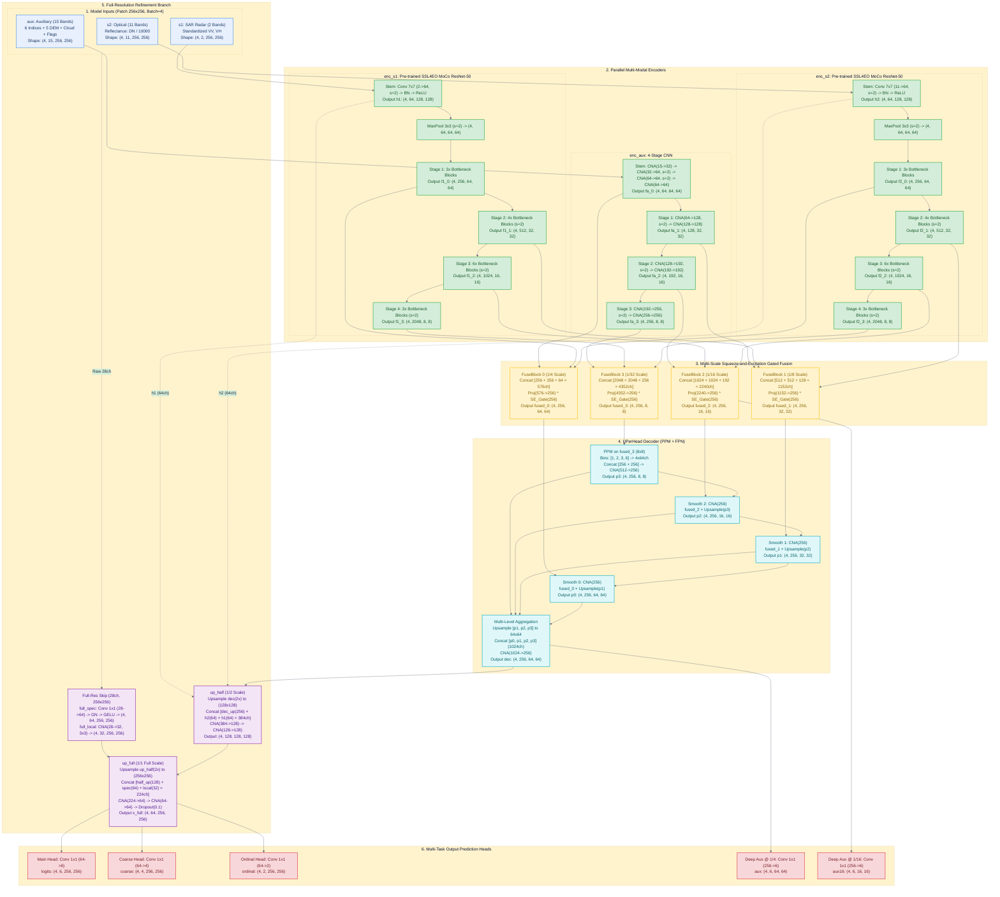
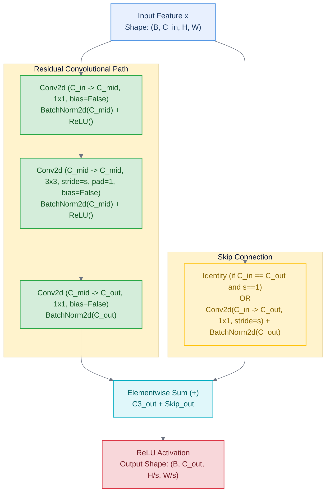

# Complete Technical Specification & Architectural Flow: `12_pretrained_terrain_upernet.ipynb`
**Model Name:** PT-UPerNet (Pretrained Terrain-Aware Unified Perceptual Parsing Network)  
**Task:** High-Resolution Inland Excess Water (IEW) & Flood Severity Semantic Segmentation  
**Inputs:** Sentinel-2 (11 Bands) + Sentinel-1 (2 Bands) + Copernicus GLO-30 DEM (5 Features) + Auxiliary Features (10 Channels) = **28 Channels Total**  
**Target Classes (6):** `0: Open surface water`, `1: Soil seriously affected`, `2: Soil moderately affected`, `3: Soil slightly affected`, `4: Vegetation affected`, `5: Not affected`  
**File Location:** [`12_pretrained_terrain_upernet.ipynb`](file:///Users/gprajwalpriyadarshan/Desktop/SEM5/DL/flood-segmentation-sentinel12/12_pretrained_terrain_upernet.ipynb)

---

## Table of Contents
1. [End-to-End File Pipeline (Start to Finish)](#1-end-to-end-file-pipeline-start-to-finish)
2. [Input Tensors, Channels & Image Sizes](#2-input-tensors-channels--image-sizes)
3. [Component 1: Encoders (Optical, Radar, Auxiliary) Block-by-Block](#3-component-1-encoders-optical-radar-auxiliary-block-by-block)
4. [Component 2: Multi-Scale Gated Fusion Blocks (`FuseBlock`)](#4-component-2-multi-scale-gated-fusion-blocks-fuseblock)
5. [Component 3: UPerNet Decoder (`UPerHead`: PPM + FPN)](#5-component-3-upernet-decoder-uperhead-ppm--fpn)
6. [Component 4: Full-Resolution Refinement Branch](#6-component-4-full-resolution-refinement-branch)
7. [Component 5: Output Heads & Hierarchical Probability Composition](#7-component-5-output-heads--hierarchical-probability-composition)
8. [Master Architectural Mermaid Diagram (With Every Block & Tensor Size)](#8-master-architectural-mermaid-diagram-with-every-block--tensor-size)
9. [Detailed Mermaid Diagrams for Individual Subsystems](#9-detailed-mermaid-diagrams-for-individual-subsystems)
10. [Loss Formulation, Calibration & Performance Metrics](#10-loss-formulation-calibration--performance-metrics)

---

## 1. End-to-End File Pipeline (Start to Finish)

The entire notebook executes sequentially across 14 distinct stages:

```mermaid
%%{init: {'theme': 'base', 'themeVariables': { 'primaryColor': '#E8F0FE', 'primaryTextColor': '#1F2937', 'primaryBorderColor': '#4A90E2', 'lineColor': '#6B7280', 'secondaryColor': '#D4EDDA', 'tertiaryColor': '#FFF3CD' }}}%%
flowchart TD
    subgraph DataStage["Phase 1: Ingestion, Terrain Extraction & Patch Sampling"]
        A["1. Configure Environment<br/>PyTorch 2.6, AMP bfloat16, Seed=0"]
        B["2. Load Split Rasters<br/>12 Train, 2 Val, 9 Test Scenes"]
        C["3. Copernicus GLO-30 DEM Processing<br/>Fetch AWS S3 COGs -> Reproject to 10m Scene Grid -> 5 Topographic Channels"]
        D["3b. Class-Aware Patch Indexing<br/>2D Integral Images on 64px Grid -> 40,139 Train Patches (256x256)"]
        A --> B --> C --> D
    end

    subgraph ModelStage["Phase 2: Model Surgery & Loss Definition"]
        E["4. Initialize PT-UPerNet (59.66M params)<br/>Dual SSL4EO MoCo ResNet-50s + AuxEncoder + FuseBlocks + UPerHead"]
        F["5. Structured Multi-Task Loss<br/>Main Soft CE + Dice + Coarse CE + Ordinal BCE + Deep Aux"]
        D --> E --> F
    end

    subgraph TrainStage["Phase 3: Staged Fine-Tuning & Validation"]
        G["6-7. Staged Fine-Tuning (20 Epochs)<br/>Ep 1-2: Backbones Frozen (Train Heads @ 1e-3)<br/>Ep 3-20: Unfrozen OneCycleLR (Backbones @ 1e-4, Heads @ 1e-3) + EMA (0.995)"]
        H["8. Plot Training Diagnostics<br/>Loss Curves & Validation Macro-F1 Progression"]
        I["9. Feature Contribution Ablations<br/>Validation Patches: Full vs. Terrain Zeroed vs. Radar Zeroed"]
        F --> G --> H --> I
    end

    subgraph InferStage["Phase 4: Full-Scene Tiled Inference & Benchmark Evaluation"]
        J["10. Overlapping Tiled Inference & Calibration<br/>640x640 Windows (64px Margin, 512x512 Center) + Flip TTA<br/>Fit alpha=1.0 & Logit Biases on Held-Out Val Scenes"]
        K["11. Benchmark Evaluation on 9 Test Scenes<br/>135M Pixels: Raw Argmax vs. Calibrated Predictions"]
        L["12. Confusion Matrix & Normalized Error Breakdown"]
        M["13. Prediction Visualizations<br/>True Color RGB, TPI 1.5km Map, Ground Truth, Calibrated Map"]
        N["14. Output Serialization<br/>Save Metrics to outputs/ptuper_results.json"]
        I --> J --> K --> L --> M --> N
    end

    style A fill:#E8F0FE,stroke:#4A90E2,stroke-width:1.5px,color:#1A365D
    style B fill:#E8F0FE,stroke:#4A90E2,stroke-width:1.5px,color:#1A365D
    style C fill:#E8F0FE,stroke:#4A90E2,stroke-width:1.5px,color:#1A365D
    style D fill:#E8F0FE,stroke:#4A90E2,stroke-width:1.5px,color:#1A365D
    style E fill:#D4EDDA,stroke:#28A745,stroke-width:1.5px,color:#155724
    style F fill:#D4EDDA,stroke:#28A745,stroke-width:1.5px,color:#155724
    style G fill:#FFF3CD,stroke:#FFC107,stroke-width:1.5px,color:#856404
    style H fill:#FFF3CD,stroke:#FFC107,stroke-width:1.5px,color:#856404
    style I fill:#FFF3CD,stroke:#FFC107,stroke-width:1.5px,color:#856404
    style J fill:#E0F7FA,stroke:#00ACC1,stroke-width:1.5px,color:#006064
    style K fill:#E0F7FA,stroke:#00ACC1,stroke-width:1.5px,color:#006064
    style L fill:#F8D7DA,stroke:#DC3545,stroke-width:1.5px,color:#721C24
    style M fill:#F3E5F5,stroke:#8E24AA,stroke-width:1.5px,color:#4A148C
    style N fill:#E2E3E5,stroke:#6C757D,stroke-width:1.5px,color:#383D41
```



---

## 2. Input Tensors, Channels & Image Sizes

### 2.1 Spatial Image Sizes Across Contexts

| Processing Context | Input Height $\times$ Width ($H \times W$) | Total Channels ($C$) | Batch Size ($B$) | Receptive Processing Description |
| :--- | :---: | :---: | :---: | :--- |
| **Training Patch** | **$256 \times 256$ pixels** | **28 channels** | **$4$** | Cropped on a 64 px grid with $\pm 32$ px spatial jitter |
| **Validation Patch** | **$256 \times 256$ pixels** | **28 channels** | **$4$** | 128 sampled evaluation windows |
| **Full Scene Ingestion** | Up to **$3600 \times 5400$ pixels** | **28 channels** | Full Scene | GeoTIFF rasters held in memory / on disk |
| **Inference Sliding Window** | **$640 \times 640$ pixels** | **28 channels** | **$1$** | $512 \times 512$ tile center + 64 px boundary reflection margin |

---

### 2.2 Complete 28-Channel Composition Breakdown

```
Total Model Inputs = s2 (11 channels) + s1 (2 channels) + aux (15 channels) = 28 Channels
```

#### Tensor 1: `s2` (Sentinel-2 Optical, 11 Channels)
- **Bands Included:** B01, B02, B03, B04, B05, B06, B07, B08, B8A, B11, B12 (B09 & B10 omitted).
- **Reflectance Transformation:** Converted from raw 16-bit DN to surface reflectance:
  $$\text{Reflectance} = \frac{\text{DN}}{10000.0}$$
- **Masking:** Clipped to $[0.0, 2.0] \times v_2$ (where $v_2$ is the optical validity flag).
- **Tensor Shape:** `(B, 11, H, W)` $\to$ `(4, 11, 256, 256)` during training.

#### Tensor 2: `s1` (Sentinel-1 SAR Radar, 2 Channels)
- **Polarizations Included:** VV and VH backscatter in decibels (dB).
- **Z-Score Normalization:**
  $$S1_{\text{norm}} = \frac{S1 - \boldsymbol{\mu}_{s1}}{\boldsymbol{\sigma}_{s1}}, \quad \boldsymbol{\mu}_{s1} = [-21.6081, -13.6686], \; \boldsymbol{\sigma}_{s1} = [3.4706, 3.0644]$$
- **Masking:** Clipped to $[-6.0, 6.0] \times v_1$ (where $v_1$ is the SAR valid pixel mask).
- **Tensor Shape:** `(B, 2, H, W)` $\to$ `(4, 2, 256, 256)` during training.

#### Tensor 3: `aux` (Engineered Auxiliary Features, 15 Channels)
All channels scaled and clipped to $[-6.0, 6.0]$:
1. **Ch 0: NDVI** = $2.0 \times \frac{\text{NIR} - \text{Red}}{\text{NIR} + \text{Red} + \epsilon}$ (Vegetation vigor)
2. **Ch 1: NDMI** = $2.0 \times \frac{\text{NIR}_{\text{narrow}} - \text{SWIR1}}{\text{NIR}_{\text{narrow}} + \text{SWIR1} + \epsilon}$ (Canopy water content)
3. **Ch 2: NDWI** = $2.0 \times \frac{\text{Green} - \text{NIR}}{\text{Green} + \text{NIR} + \epsilon}$ (Open water index)
4. **Ch 3: MNDWI** = $2.0 \times \frac{\text{Green} - \text{SWIR1}}{\text{Green} + \text{SWIR1} + \epsilon}$ (Modified water index)
5. **Ch 4: SWIR1-RED** = $2.0 \times \frac{\text{SWIR1} - \text{Red}}{\text{SWIR1} + \text{Red} + \epsilon}$ (Bare soil moisture sensitivity)
6. **Ch 5: SWIR Ratio** = $2.0 \times \frac{\text{SWIR1} - \text{SWIR2}}{\text{SWIR1} + \text{SWIR2} + \epsilon}$ (Clay hydration)
7. **Ch 6: Cloud/Haze Probability** = $\text{clip}\left(\frac{\min(\text{Blue}, \text{Red}) - 0.10}{0.20}, 0.0, 1.0\right) \times v_2$
8. **Ch 7: Optical Validity Mask ($v_2$)** = $1.0$ if valid pixel, else $0.0$
9. **Ch 8: Standardized VV/VH Cross-Polarization Ratio** = $\text{clip}\left(\frac{(\text{VV} - \text{VH}) - (-8.0403)}{2.5309}, -6.0, 6.0\right)$
10. **Ch 9: SAR Validity Mask ($v_1$)** = $1.0$ if valid pixel, else $0.0$
11. **Ch 10: Relative Elevation** = $\text{clip}\left(\frac{z - \text{median}(z)}{10.0\text{ m}}, -6.0, 6.0\right)$
12. **Ch 11: Terrain Slope** = $\text{clip}\left(\frac{\text{degrees}(\arctan(\sqrt{g_x^2 + g_y^2}))}{2.0}, -6.0, 6.0\right)$
13. **Ch 12: TPI 150m (Radius 15 px)** = $\text{clip}\left(\frac{z - \text{box\_mean}_{15}(z)}{2.0\text{ m}}, -6.0, 6.0\right)$ (Micro-depressions)
14. **Ch 13: TPI 500m (Radius 50 px)** = $\text{clip}\left(\frac{z - \text{box\_mean}_{50}(z)}{2.0\text{ m}}, -6.0, 6.0\right)$ (Hillslope vs valley)
15. **Ch 14: TPI 1.5km (Radius 150 px)** = $\text{clip}\left(\frac{z - \text{box\_mean}_{150}(z)}{2.0\text{ m}}, -6.0, 6.0\right)$ (Regional drainage basin)
- **Tensor Shape:** `(B, 15, H, W)` $\to$ `(4, 15, 256, 256)` during training.

---

## 3. Component 1: Encoders (Optical, Radar, Auxiliary) Block-by-Block

Assuming training patch dimensions: $B=4, H=256, W=256$.

### 3.1 Optical Encoder: `enc_s2` (`ResNetEncoder`, SSL4EO Pre-Trained)
Adapted from `ResNet50_Weights.SENTINEL2_ALL_MOCO` via `torchgeo`:

```
Input: s2 -> (4, 11, 256, 256)
  │
  ├── Stem:
  │     Conv2d(11 -> 64, kernel=7x7, stride=2, padding=3, bias=False)
  │     BatchNorm2d(64) [Frozen in eval mode]
  │     ReLU()
  │     Output 'h2': (4, 64, 128, 128)  [Resolution: 1/2]
  │
  ├── MaxPool2d(kernel=3x3, stride=2, padding=1)
  │     Shape: (4, 64, 64, 64)
  │
  ├── Stage 1 (layer1, 3 Bottlenecks):
  │     Bottleneck 0: [Conv 1x1 (64->64) -> Conv 3x3 (64->64) -> Conv 1x1 (64->256)] + Skip Conv 1x1 (64->256)
  │     Bottleneck 1: [Conv 1x1 (256->64) -> Conv 3x3 (64->64) -> Conv 1x1 (64->256)] + Identity
  │     Bottleneck 2: [Conv 1x1 (256->64) -> Conv 3x3 (64->64) -> Conv 1x1 (64->256)] + Identity
  │     Output 'f2[0]': (4, 256, 64, 64)  [Resolution: 1/4]
  │
  ├── Stage 2 (layer2, 4 Bottlenecks, stride=2):
  │     Bottleneck 0: [Conv 1x1 (256->128) -> Conv 3x3 (128->128, s=2) -> Conv 1x1 (128->512)] + Skip Conv 1x1 (s=2)
  │     Bottlenecks 1-3: [Conv 1x1 (512->128) -> Conv 3x3 (128->128) -> Conv 1x1 (128->512)] + Identity
  │     Output 'f2[1]': (4, 512, 32, 32)  [Resolution: 1/8]
  │
  ├── Stage 3 (layer3, 6 Bottlenecks, stride=2):
  │     Bottleneck 0: [Conv 1x1 (512->256) -> Conv 3x3 (256->256, s=2) -> Conv 1x1 (256->1024)] + Skip Conv 1x1 (s=2)
  │     Bottlenecks 1-5: [Conv 1x1 (1024->256) -> Conv 3x3 (256->256) -> Conv 1x1 (256->1024)] + Identity
  │     Output 'f2[2]': (4, 1024, 16, 16)  [Resolution: 1/16]
  │
  └── Stage 4 (layer4, 3 Bottlenecks, stride=2):
        Bottleneck 0: [Conv 1x1 (1024->512) -> Conv 3x3 (512->512, s=2) -> Conv 1x1 (512->2048)] + Skip Conv 1x1 (s=2)
        Bottlenecks 1-2: [Conv 1x1 (2048->512) -> Conv 3x3 (512->512) -> Conv 1x1 (512->2048)] + Identity
        Output 'f2[3]': (4, 2048, 8, 8)  [Resolution: 1/32]
```

---

### 3.2 SAR Radar Encoder: `enc_s1` (`ResNetEncoder`, SSL4EO Pre-Trained)
Initialized from `ResNet50_Weights.SENTINEL1_ALL_MOCO` via `torchgeo`:
- **Input:** `s1` $\to$ `(4, 2, 256, 256)`
- **Stem:** `Conv2d(2 -> 64, 7x7, s=2, p=3) -> BN -> ReLU` $\to$ **`h1` Output:** `(4, 64, 128, 128)` ($1/2$ scale)
- **Stages 1–4:** Identical Bottleneck block topologies:
  - **`f1[0]` Output:** `(4, 256, 64, 64)` ($1/4$ scale)
  - **`f1[1]` Output:** `(4, 512, 32, 32)` ($1/8$ scale)
  - **`f1[2]` Output:** `(4, 1024, 16, 16)` ($1/16$ scale)
  - **`f1[3]` Output:** `(4, 2048, 8, 8)` ($1/32$ scale)

---

### 3.3 Auxiliary CNN Encoder: `enc_aux` (`AuxEncoder`)
Custom lightweight CNN processing indices, validity masks, and DEM channels:
*(Helper layer: `cna(cin, cout, k=3, s=1)` = `Conv2d(cin, cout, k, s, k//2, bias=False) -> GroupNorm(8, cout) -> GELU()`)*

```
Input: aux -> (4, 15, 256, 256)
  │
  ├── Stem:
  │     cna(15 -> 32, k=3, s=1)  -> Shape: (4, 32, 256, 256)
  │     cna(32 -> 64, k=3, s=2)  -> Shape: (4, 64, 128, 128)
  │     cna(64 -> 64, k=3, s=2)  -> Shape: (4, 64, 64, 64)
  │     cna(64 -> 64, k=3, s=1)  -> Output 'fa[0]': (4, 64, 64, 64)   [Resolution: 1/4]
  │
  ├── Stage 1:
  │     cna(64 -> 128, k=3, s=2) -> Shape: (4, 128, 32, 32)
  │     cna(128 -> 128, k=3, s=1)-> Output 'fa[1]': (4, 128, 32, 32)  [Resolution: 1/8]
  │
  ├── Stage 2:
  │     cna(128 -> 192, k=3, s=2)-> Shape: (4, 192, 16, 16)
  │     cna(192 -> 192, k=3, s=1)-> Output 'fa[2]': (4, 192, 16, 16)  [Resolution: 1/16]
  │
  └── Stage 3:
        cna(192 -> 256, k=3, s=2)-> Shape: (4, 256, 8, 8)
        cna(256 -> 256, k=3, s=1)-> Output 'fa[3]': (4, 256, 8, 8)    [Resolution: 1/32]
```

---

## 4. Component 2: Multi-Scale Gated Fusion Blocks (`FuseBlock`)

At each scale $i \in \{0, 1, 2, 3\}$, optical features $f_2[i]$, radar features $f_1[i]$, and auxiliary features $f_a[i]$ are combined:

```
FuseBlock[i] Structure:
  Input Features: f2[i] (C_s2) + f1[i] (C_s1) + fa[i] (C_aux)
    │
    ├── torch.cat([f2[i], f1[i], fa[i]], dim=1) -> Shape: (4, C_in, H_i, W_i)
    │
    ├── Projection Path:
    │     Conv2d(C_in -> 256, kernel=1x1, bias=False)
    │     GroupNorm(8, 256) + GELU()
    │     Conv2d(256 -> 256, kernel=3x3, padding=1, bias=False)
    │     GroupNorm(8, 256) + GELU()
    │     Yields: y of shape (4, 256, H_i, W_i)
    │
    ├── Squeeze-and-Excitation (SE) Gating Branch:
    │     AdaptiveAvgPool2d(1)                     -> Shape: (4, 256, 1, 1)
    │     Conv2d(256 -> 32, kernel=1x1) + GELU()  -> Shape: (4, 32, 1, 1)
    │     Conv2d(32 -> 256, kernel=1x1)            -> Shape: (4, 256, 1, 1)
    │     Sigmoid()                                -> Gate Vector: (4, 256, 1, 1) in [0, 1]
    │
    └── Residual Modulation:
          fused[i] = y * Gate(y)                   -> Output Shape: (4, 256, H_i, W_i)
```

### Fusion Stage Channel Dimensions:

| Scale Stage | Resolution | Optical $f_2$ | Radar $f_1$ | Aux $f_a$ | Total Concat $C_{\text{in}}$ | Fused Output Shape |
| :---: | :---: | :---: | :---: | :---: | :---: | :---: |
| **Stage 0 (`fuse[0]`)** | $1/4$ ($64 \times 64$) | 256 | 256 | 64 | **576 channels** | `(4, 256, 64, 64)` |
| **Stage 1 (`fuse[1]`)** | $1/8$ ($32 \times 32$) | 512 | 512 | 128 | **1152 channels** | `(4, 256, 32, 32)` |
| **Stage 2 (`fuse[2]`)** | $1/16$ ($16 \times 16$) | 1024 | 1024 | 192 | **2240 channels** | `(4, 256, 16, 16)` |
| **Stage 3 (`fuse[3]`)** | $1/32$ ($8 \times 8$) | 2048 | 2048 | 256 | **4352 channels** | `(4, 256, 8, 8)` |

---

## 5. Component 3: UPerNet Decoder (`UPerHead`: PPM + FPN)

The Unified Perceptual Parsing decoder ingests the 4 fused tensors:

```
Inputs: fused[0] (64x64), fused[1] (32x32), fused[2] (16x16), fused[3] (8x8) -- all 256 channels
  │
  ├── 1. Pyramid Pooling Module (PPM) on fused[3] (8x8):
  │     Bin 1: AdaptiveAvgPool2d(1) -> Conv 1x1 (256->64) -> GN -> GELU -> Bilinear Upsample(8x8) -> (4, 64, 8, 8)
  │     Bin 2: AdaptiveAvgPool2d(2) -> Conv 1x1 (256->64) -> GN -> GELU -> Bilinear Upsample(8x8) -> (4, 64, 8, 8)
  │     Bin 3: AdaptiveAvgPool2d(3) -> Conv 1x1 (256->64) -> GN -> GELU -> Bilinear Upsample(8x8) -> (4, 64, 8, 8)
  │     Bin 6: AdaptiveAvgPool2d(6) -> Conv 1x1 (256->64) -> GN -> GELU -> Bilinear Upsample(8x8) -> (4, 64, 8, 8)
  │     Concat: [fused[3], pool_1, pool_2, pool_3, pool_6] -> Shape: (4, 512, 8, 8)
  │     ppm_out: cna(512 -> 256, k=3, s=1)                 -> Output 'p[3]': (4, 256, 8, 8)
  │
  ├── 2. Top-Down FPN Smoothing:
  │     p[2] = smooth[2](fused[2] + BilinearUpsample_2x(p[3])) -> Shape: (4, 256, 16, 16)
  │     p[1] = smooth[1](fused[1] + BilinearUpsample_2x(p[2])) -> Shape: (4, 256, 32, 32)
  │     p[0] = smooth[0](fused[0] + BilinearUpsample_2x(p[1])) -> Shape: (4, 256, 64, 64)
  │
  └── 3. Multi-Level Feature Aggregation:
        Bilinear Upsample p[1], p[2], p[3] to (64 x 64)
        torch.cat([p[0], up(p[1]), up(p[2]), up(p[3])], dim=1) -> Shape: (4, 1024, 64, 64)
        fuse: cna(1024 -> 256, k=3, s=1)                       -> Decoder Output 'dec': (4, 256, 64, 64)
```

---

## 6. Component 4: Full-Resolution Refinement Branch

Recovers fine 10-meter spatial structures lost during downsampling:

```
Decoder Output: dec -> (4, 256, 64, 64)
  │
  ├── Stage 1: Half-Resolution Restoration (1/2 Scale, 128x128)
  │     F.interpolate(dec, scale_factor=2, mode="bilinear")  -> Shape: (4, 256, 128, 128)
  │     Optical Stem Skip 'h2': (4, 64, 128, 128)
  │     SAR Stem Skip 'h1':     (4, 64, 128, 128)
  │     Concat: [dec_up (256) + h2 (64) + h1 (64)]          -> Shape: (4, 384, 128, 128)
  │     up_half: cna(384 -> 128) -> cna(128 -> 128)         -> Shape: (4, 128, 128, 128)
  │
  └── Stage 2: Full-Resolution Reconstruction (1/1 Scale, 256x256)
        F.interpolate(up_half, scale_factor=2, mode="bilinear") -> Shape: (4, 128, 256, 256)
        │
        ├── Raw Full-Resolution Branch: full_in (28 Channels, 256x256)
        │     - Standardized S2: 11 channels
        │     - Standardized S1: 2 channels
        │     - Auxiliary (indices, cloud, DEM, valid): 15 channels
        │     full_spec:  Conv 1x1 (28->64) -> GN -> GELU -> Conv 1x1 (64->64) -> GN -> GELU -> (4, 64, 256, 256)
        │     full_local: cna(28 -> 32, k=3, s=1)                                           -> (4, 32, 256, 256)
        │
        ├── Concat: [x_up (128) + full_spec (64) + full_local (32)] -> Shape: (4, 224, 256, 256)
        ├── up_full: cna(224 -> 64) -> cna(64 -> 64)               -> Shape: (4, 64, 256, 256)
        └── Dropout2d(p=0.1)                                        -> Feature Tensor 'x_full': (4, 64, 256, 256)
```

---

## 7. Component 5: Output Heads & Hierarchical Probability Composition

```
Final Feature Tensor: x_full (4, 64, 256, 256)
  │
  ├── 1. Main Head:       Conv2d(64 -> 6, kernel=1x1) -> 'logits'  : (4, 6, 256, 256)
  ├── 2. Coarse Head:     Conv2d(64 -> 4, kernel=1x1) -> 'coarse'  : (4, 4, 256, 256)
  ├── 3. Ordinal Head:    Conv2d(64 -> 2, kernel=1x1) -> 'ordinal' : (4, 2, 256, 256)
  ├── 4. Deep Aux @ 1/4:  Conv2d(256 -> 6, kernel=1x1) on 'dec'    -> 'aux'    : (4, 6, 64, 64)
  └── 5. Deep Aux @ 1/16: Conv2d(256 -> 6, kernel=1x1) on 'fused[2]'-> 'aux16': (4, 6, 16, 16)
```

### Hierarchical Probability Composition Math:
1. Flat probabilities: $P_{\text{main}} = \text{Softmax}(\text{logits}) \in \mathbb{R}^{6}$
2. Coarse probabilities: $P_c = \text{Softmax}(\text{coarse}) \in \mathbb{R}^{4}$ where indices correspond to: `[0: Water, 1: Soil, 2: Vegetation, 3: Not Affected]`
3. Ordinal soil flood severity gates:
   $$\text{ge}_1 = \sigma(z_0) \quad (\text{Probability } \text{Soil Severity} \ge \text{Moderate})$$
   $$\text{ge}_2 = \text{ge}_1 \cdot \sigma(z_1) \quad (\text{Probability } \text{Soil Severity} = \text{Serious})$$
4. Hierarchically decomposed 6-class probability vector:
   $$P_h = \begin{bmatrix} P_c[0] & (\text{Water}) \\ P_c[1] \cdot \text{ge}_2 & (\text{Soil Seriously Affected}) \\ P_c[1] \cdot (\text{ge}_1 - \text{ge}_2) & (\text{Soil Moderately Affected}) \\ P_c[1] \cdot (1 - \text{ge}_1) & (\text{Soil Slightly Affected}) \\ P_c[2] & (\text{Vegetation Affected}) \\ P_c[3] & (\text{Not Affected}) \end{bmatrix}$$
5. Blended Probability:
   $$P_{\text{blend}} = (1 - \alpha) P_{\text{main}} + \alpha P_h \quad (\text{Fitted } \alpha = 1.0)$$
6. Calibrated Prediction:
   $$\hat{y} = \arg\max_{k \in \{0..5\}} \left(\log(P_{\text{blend}}[k] + 10^{-8}) + \mathbf{b}[k]\right)$$
   Where $\mathbf{b} = [+0.25, +0.25, -0.25, -0.50, +0.25, +0.75]$.

---

## 8. Master Architectural Mermaid Diagram (With Every Block & Tensor Size)



---

## 9. Detailed Mermaid Diagrams for Individual Subsystems

### Diagram 3: Internal Anatomy of a Single ResNet-50 Bottleneck Block



---

### Diagram 4: Boundary-Free Tiling & Overlap Assembly Pipeline

```mermaid
%%{init: {'theme': 'base', 'themeVariables': { 'primaryColor': '#E8F0FE', 'primaryTextColor': '#1F2937', 'primaryBorderColor': '#4A90E2', 'lineColor': '#6B7280', 'secondaryColor': '#D4EDDA', 'tertiaryColor': '#FFF3CD' }}}%%
flowchart TD
    SCENE["Full Geographic Scene<br/>Spatial Shape: (H, W) e.g., 3600 x 5400 px<br/>Total Channels: 28 Channels"]
    
    subgraph SlidingWindow["1. Overlapping Window Extraction"]
        GRID["Generate Tile Starts: r0, c0 on 512px Stride"]
        WINDOW["Extract 640 x 640 Window:<br/>Rows: [r0 - 64 : r0 + 512 + 64]<br/>Cols: [c0 - 64 : c0 + 512 + 64]<br/>Reflect-pad outer scene borders"]
        GRID --> WINDOW
    end
    SCENE --> GRID

    subgraph TTABranch["2. Test-Time Augmentation (TTA)"]
        F_ORIG["Original Window (640x640)"]
        F_FLIP["Horizontal Flip (640x640)"]
        WINDOW --> F_ORIG & F_FLIP

        M_ORIG["Model Forward: pm1, ph1"]
        M_FLIP["Model Forward: pm2, ph2"]
        F_ORIG --> M_ORIG
        F_FLIP --> M_FLIP

        INV_FLIP["Invert Flip on pm2, ph2<br/>Average: pm = (pm1 + flip(pm2))/2, ph = (ph1 + flip(ph2))/2"]
        M_ORIG & M_FLIP --> INV_FLIP
    end

    subgraph Calibration["3. Hierarchical Blend & Logit Bias"]
        BLEND["Blend Probabilities: P = (1 - alpha)*pm + alpha*ph<br/>Fitted alpha = 1.0 (Pure Hierarchical)"]
        INV_FLIP --> BLEND
        BIAS["Apply Logit Bias: log(P + 1e-8) + [0.25, 0.25, -0.25, -0.5, 0.25, 0.75]"]
        BLEND --> BIAS
        ARGMAX["Pixel Class = argmax(logP + Bias)<br/>Shape: (640, 640)"]
        BIAS --> ARGMAX
    end

    subgraph SeamlessCrop["4. Seam Elimination & Assembly"]
        CROP["Discard 64px Boundary Margin<br/>Crop Slice: [64 : 64 + 512, 64 : 64 + 512]<br/>Retains Center 512 x 512 Tile"]
        ARGMAX --> CROP
        PASTE["Insert into Full Scene Raster at [r0 : r0 + 512, c0 : c0 + 512]"]
        CROP --> PASTE
        OUTPUT["Seamless Full-Scene Segmentation Map<br/>Zero Edge Artifacts, Native 10m Accuracy"]
        PASTE --> OUTPUT
    end

    style SCENE fill:#E8F0FE,stroke:#4A90E2,stroke-width:1.5px,color:#1A365D
    style GRID fill:#E8F0FE,stroke:#4A90E2,stroke-width:1.5px,color:#1A365D
    style WINDOW fill:#E8F0FE,stroke:#4A90E2,stroke-width:1.5px,color:#1A365D
    style F_ORIG fill:#D4EDDA,stroke:#28A745,stroke-width:1.5px,color:#155724
    style F_FLIP fill:#D4EDDA,stroke:#28A745,stroke-width:1.5px,color:#155724
    style M_ORIG fill:#D4EDDA,stroke:#28A745,stroke-width:1.5px,color:#155724
    style M_FLIP fill:#D4EDDA,stroke:#28A745,stroke-width:1.5px,color:#155724
    style INV_FLIP fill:#D4EDDA,stroke:#28A745,stroke-width:1.5px,color:#155724
    style BLEND fill:#FFF3CD,stroke:#FFC107,stroke-width:1.5px,color:#856404
    style BIAS fill:#FFF3CD,stroke:#FFC107,stroke-width:1.5px,color:#856404
    style ARGMAX fill:#FFF3CD,stroke:#FFC107,stroke-width:1.5px,color:#856404
    style CROP fill:#E0F7FA,stroke:#00ACC1,stroke-width:1.5px,color:#006064
    style PASTE fill:#E0F7FA,stroke:#00ACC1,stroke-width:1.5px,color:#006064
    style OUTPUT fill:#F8D7DA,stroke:#DC3545,stroke-width:1.5px,color:#721C24
```



---

## 10. Loss Formulation, Calibration & Performance Metrics

### 10.1 Multi-Task Loss Formulation
$$\mathcal{L}_{\text{total}} = \mathcal{L}_{\text{main}} + 0.3 \mathcal{L}_{\text{aux}} + 0.2 \mathcal{L}_{\text{aux16}} + 0.4 \mathcal{L}_{\text{coarse}} + 0.4 \mathcal{L}_{\text{ordinal}}$$
- **$\mathcal{L}_{\text{main}}$**: Soft Cross-Entropy with ordinal label smoothing ($\epsilon=0.15$) + $0.5 \times$ soft Dice loss. Class weights: $[0.58, 1.96, 1.73, 0.75, 0.87, 0.12]$.
- **$\mathcal{L}_{\text{coarse}}$**: 4-class weighted cross-entropy over Water, Soil, Vegetation, Not Affected ($[0.58, 0.74, 0.87, 0.12]$).
- **$\mathcal{L}_{\text{ordinal}}$**: Two-stage binary cross-entropy on soil pixels:
  $$\mathcal{L}_{\text{ord}} = \text{BCE}(z_0, \mathbb{I}(\text{rank}\ge 1), \text{pos\_weight}=2.11) + \text{BCE}(z_1, \mathbb{I}(\text{rank}\ge 2), \text{pos\_weight}=1.19)$$

---

### 10.2 Final Quantitative Test Metrics (Across 135,061,565 Test Pixels)

| Evaluation Metric | Raw Argmax | Calibrated ($\alpha=1.0, \mathbf{b}$) | Benchmark Baseline (RUPNet) | Improvement |
| :--- | :---: | :---: | :---: | :---: |
| **Overall Pixel Accuracy** | **97.88%** | **97.95%** | — | — |
| **Mean Class Accuracy (Average Recall)** | **83.85%** | **80.98%** | — | — |
| **Macro-F1 (All 6 Classes)** | **78.62%** | **78.69%** | — | — |
| **Macro-F1 (Water-Related, Classes 0–4)** | **74.55%** | **74.61%** | — | — |
| **Pixel-Weighted F1 (Classes 0–4, Table 1)** | **84.12%** | **84.31%** | **81.19%** | **+3.12%** |
| **Mean IoU (All 6 Classes)** | **67.08%** | **67.55%** | — | — |
| **Mean IoU (Water-Related, Classes 0–4)** | **60.85%** | **61.42%** | — | — |

---

### 10.3 Per-Class Performance Breakdown (Calibrated)

| Class ID | Class Description | Precision | Recall (Accuracy) | F1-Score | IoU (Jaccard) | Ground Truth Pixels |
| :---: | :--- | :---: | :---: | :---: | :---: | :---: |
| **0** | Open surface water (raw 2) | 98.32% | 98.86% | **98.59%** | 97.22% | 4,774,539 |
| **1** | Soil seriously affected (raw 3) | 69.54% | 71.61% | **70.56%** | 54.51% | 313,249 |
| **2** | Soil moderately affected (raw 4) | 59.72% | 61.86% | **60.77%** | 43.65% | 372,229 |
| **3** | Soil slightly affected (raw 5) | 66.26% | 69.17% | **67.68%** | 51.15% | 2,101,611 |
| **4** | Vegetation affected (raw 6) | 67.44% | 85.57% | **75.43%** | 60.55% | 2,272,466 |
| **5** | Not affected (raw 7) | 99.39% | 98.79% | **99.09%** | 98.20% | 125,227,471 |

---

### 10.4 Feature Ablation Study (Validation Set)
- **Full Model:** **80.00%** Macro-F1
- **Terrain Zeroed (No DEM):** **79.09%** Macro-F1 (Flooded vegetation drops by $-4.32\%$, seriously affected soil drops by $-1.66\%$)
- **Sentinel-1 Zeroed (No Radar):** **74.70%** Macro-F1 (Severely affected soil drops by $-14.65\%$, flooded vegetation drops by $-14.60\%$)

---

### 10.5 Repository Pipeline Benchmark Comparison

| Class / Metric | Notebook 10<br/>(Spectral ResUNet) | Notebook 11<br/>(Temporal Radar Former) | Notebook 12<br/>(PT-UPerNet) | Paper Benchmark<br/>(RUPNet, Table 1) |
| :--- | :---: | :---: | :---: | :---: |
| Open Surface Water F1 | 98.62% | 98.40% | **98.59%** | — |
| Soil Seriously Affected F1 | **71.04%** | 67.43% | **70.56%** | — |
| Soil Moderately Affected F1 | 60.20% | 57.77% | **60.77%** | — |
| Soil Slightly Affected F1 | 63.54% | 56.44% | **67.68%** | — |
| Vegetation Affected F1 | 67.22% | 64.18% | **75.43%** | — |
| Not Affected F1 | 98.56% | 98.41% | **99.09%** | — |
| **Macro-F1 (6 classes)** | 76.53% | 73.77% | **78.69%** | — |
| **Pixel-Weighted F1 (Classes 0–4)** | 81.53% | 79.00% | **84.31%** | 81.19% |
