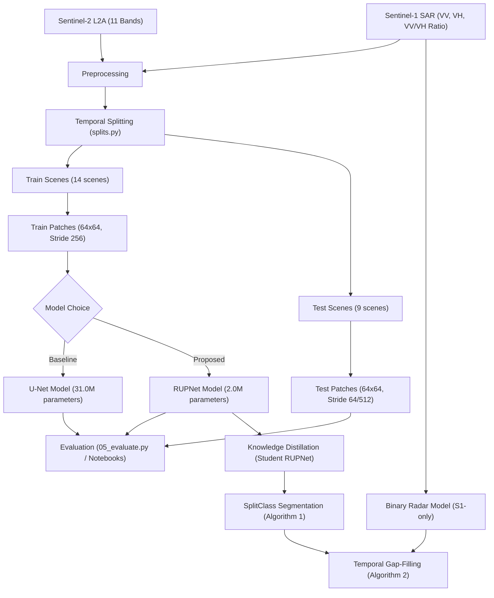

# Inland Excess Water (IEW) Monitoring using Sentinel-1/2

This repository contains the replication codebase for the paper:  
**"Inland Excess Water (IEW) Monitoring Using Sentinel-1/2: A SplitClass Segmentation and Temporal Gap-Filling Approach"** (ICCVW 2025, Sustainability with Earth Observation and AI Workshop).

*   **Paper Webpage:** [IEEE/CVF Open Access Paper Page](https://openaccess.thecvf.com/content/ICCV2025W/Sustainability/html/Ibrahim_Inland_Excess_Water_IEW_Monitoring_Using_Sentinel-12_A_SplitClass_Segmentation_ICCVW_2025_paper.html)
*   **Official Website & Dataset:** [Water Detection IEW-Seg Page](https://waterdetection.github.io/water_detection/)

---

## 1. Project Overview

Inland Excess Water (IEW)—which encompasses waterlogging and seasonal soil saturation—is a major environmental and agricultural risk factor in low-lying agricultural plains (such as the Hungarian Great Plain). 

This project aims to reproduce the paper's framework for fine-grained monitoring of excess water using multi-source satellite data:
1.  **Sentinel-2 Optical Data:** 11 bands (excluding B9 and B10) used for fine-grained classification across 6 waterlogging stages.
2.  **Sentinel-1 SAR Data:** 3 bands (Sigma-0 VV, VH, and the VV/VH ratio) used as a cloud-penetrating radar input for gap-filling.



---

## 2. Directory Structure

```text
.
├── configs/
│   └── data.yaml                 # Dataset paths, bands, class lists, and training parameters
├── docs/
│   ├── PHASE_1_PRD.md            # Product Requirement Document
│   ├── PHASE_2_TRD.md            # Technical Requirement Document
│   ├── PHASE_3_IMPLEMENTATION_PLAN.md # Implementation plan and milestones
│   └── PHASE_4_EXPERIMENTATION_RESULTS.md # Results tracker matrix (template)
├── outputs/
│   ├── checkpoints/              # Saved model weights (.pt files)
│   ├── patches/                  # Cached sliding-window patches
│   └── class_stats.csv           # Pre-computed class pixel distributions
├── scripts/
│   ├── 00_inspect_dataset.py     # Verifies dataset shape, CRS, labels, and bounding boxes
│   ├── 02_class_statistics.py    # Gathers class distribution stats for class weights
│   ├── 03_extract_patches.py     # Performs pre-extraction of patches
│   ├── 04_train.py               # Main training script (supports UNet / RUPNet)
│   ├── 05_evaluate.py            # Custom test set evaluation script
│   └── compute_stats.py          # Script for channel-wise mean and std calculations
├── src/
│   ├── data/
│   │   ├── patch_dataset.py      # PyTorch Dataset implementation
│   │   ├── raster_io.py          # Rasterio geoTIFF helpers
│   │   └── splits.py             # Script aligning S1, S2, and GT splits
│   ├── losses/
│   │   ├── generalized_dice.py   # Class-weighted Generalized Dice Loss
│   │   └── weighted_focal.py     # Class-weighted Focal Loss
│   └── models/
│       ├── rupnet.py             # Residual Upsampling Network architecture (2.05M parameters)
│       └── unet.py               # Baseline U-Net architecture (31.04M parameters)
├── tests/
│   └── test_dataset.py           # Unit tests for Dataset loading
├── unet_baseline.ipynb           # Notebook for baseline U-Net training/evaluation
├── rupnet_training.ipynb         # Notebook for RUPNet training/evaluation
└── sen12flood-eda.ipynb          # Exploratory Data Analysis notebook
```

---

## 3. Dataset Splits & Classes

The **IEW-Seg** dataset covers two national parks in Hungary: **BNPI** (Bükk National Park Directorate, Heves Steppes area) and **KNPI** (Kiskunság National Park Directorate). 

*   **Training Set (14 Scenes):** 7 BNPI scenes + 7 KNPI scenes.
*   **Testing Set (9 Scenes):** 4 BNPI scenes + 5 KNPI scenes.

Each pixel is categorized into one of 6 valid categories:
1.  **Open surface water (Class 2 / ID 0)**
2.  **Soil seriously affected by waterlogging (Class 3 / ID 1)**
3.  **Soil moderately affected by waterlogging (Class 4 / ID 2)**
4.  **Soil slightly affected by waterlogging (Class 5 / ID 3)**
5.  **Vegetation affected by waterlogging (Class 6 / ID 4)**
6.  **Not affected areas (Class 7 / ID 5)**

*(Cloud/Shadow classes 10 & 11 are masked out during loss calculation).*

---

## 4. Current Experimental Results

Both models were trained using Generalized Dice Loss (GDL) + Weighted Focal Loss (WFL) for **8 epochs** with a training stride of `256` (representing 3,388 training patches). Evaluation was performed on non-overlapping test patches (32,691 test patches):

| Metric | U-Net Baseline | RUPNet |
| :--- | :---: | :---: |
| **Model Size (Params)** | 31.04M | **2.05M (15x smaller)** |
| **Training Loss (Epoch 8)** | `1.0217` (Under-converged) | **`0.8400`** (Healthy convergence) |
| **Validation Loss (Epoch 8)**| `1.0207` | **`0.9167`** |
| **Overall Pixel Accuracy** | **31.59%** | **82.22%** |
| **Overall Precision** | **93.43%** | **96.53%** |
| **Overall F1-Score** | **43.75%** | **87.96%** |
| **Class 7 Recall (Not Affected)**| 29.32% | **82.54%** |
| **Class 2 Recall (Open Water)** | 78.49% | **87.87%** |

---

## 5. Next Project Phases

1.  **Knowledge Distillation:** Implement student RUPNet distillation (`scripts/06_distill_student.py`) to transfer features from a frozen RUPNet teacher.
2.  **SplitClass Segmentation:** Implement Algorithm 1 (`src/postprocess/splitclass.py`) to classify low-confidence pixels into dual-class labels.
3.  **Temporal Gap-Filling:** Train a binary Sentinel-1 radar model and implement Algorithm 2 (`src/postprocess/temporal_gapfill.py`) to resolve cloud gaps in optical data.
