<div align="center">

# Inland Excess Water (IEW) Monitoring with Sentinel-1/2

### Fine-grained waterlogging segmentation from satellite optical + radar imagery, from a paper replication to two new architectures

<p>
  
  
  
  
</p>
<p>
  
  
  
  
  
  
  
  
  
  
</p>
<p>
  
  
  
  
</p>

</div>

---

## Table of contents

1. [The problem](#1-the-problem)
2. [What this repository contains](#2-what-this-repository-contains)
3. [Dataset](#3-dataset)
4. [System overview](#4-system-overview)
5. [The paper pipeline (notebooks 01–10)](#5-the-paper-pipeline-notebooks-0110)
6. [New architectures (notebooks 11 and 12)](#6-new-architectures-notebooks-11-and-12)
7. [Results so far](#7-results-so-far)
8. [Training and inference protocol](#8-training-and-inference-protocol)
9. [Tech stack](#9-tech-stack)
10. [Quick start](#10-quick-start)
11. [Repository layout](#11-repository-layout)
12. [Documentation map](#12-documentation-map)
13. [Known limitations and housekeeping](#13-known-limitations-and-housekeeping)
14. [References and license](#14-references-and-license)

---

## 1. The problem

Most satellite water-mapping tools answer a yes/no question: *is this pixel open water?* **Inland excess water (IEW)**, waterlogged soil and water-stressed vegetation that never becomes a visible lake, is invisible to that kind of map, yet it damages crops and infrastructure across flat lowland regions such as the Hungarian plain.

This project builds a **6-class, pixel-level IEW map** from two complementary satellites:

| Satellite | Sees | Strength | Weakness |
|---|---|---|---|
| **Sentinel-2** (optical, 11 bands) | Colour, vegetation, soil moisture in the shortwave infrared | Fine-grained severity | Blocked by clouds |
| **Sentinel-1** (radar, VV/VH) | Surface roughness and moisture | Sees through clouds, day or night | Only rough water / non-water |

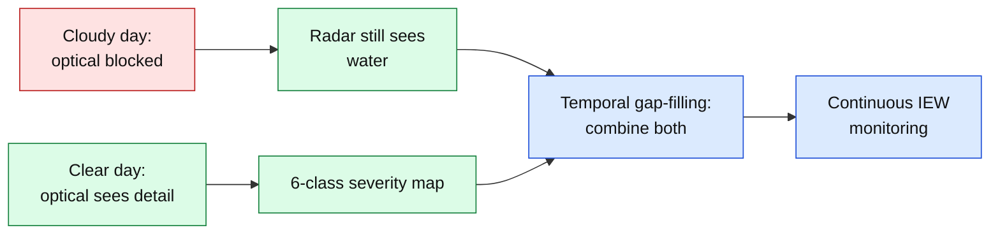

### The 6 target classes

| Index | Raw label | Class | Share of training pixels |
|---|---|---|---|
| 0 | 2 | Open surface water | 3.66 % |
| 1 | 3 | Soil, seriously affected | 0.32 % |
| 2 | 4 | Soil, moderately affected | 0.41 % |
| 3 | 5 | Soil, slightly affected | 2.22 % |
| 4 | 6 | Vegetation affected | 1.65 % |
| 5 | 7 | Not affected | 91.73 % |
| – | 10, 11 | Cloud / cloud shadow | masked out of loss and evaluation |

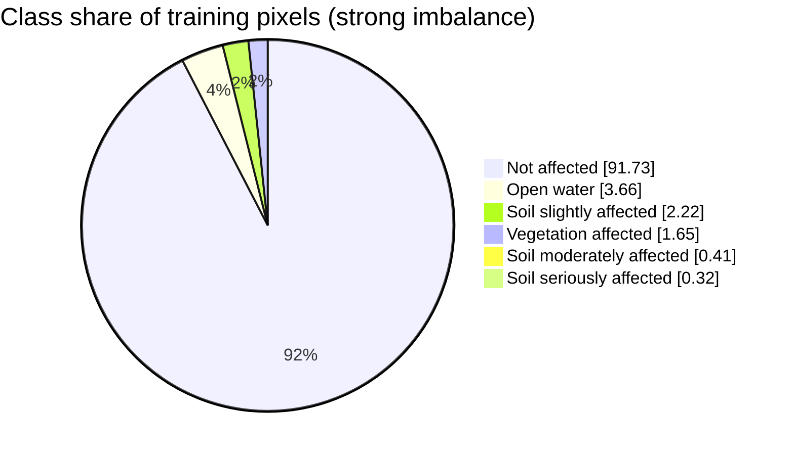

The three soil-severity classes make up under 3 % of pixels and are neighbouring grades of the same thing, which is why they are the hard part of the problem.

---

## 2. What this repository contains

The project has three layers:

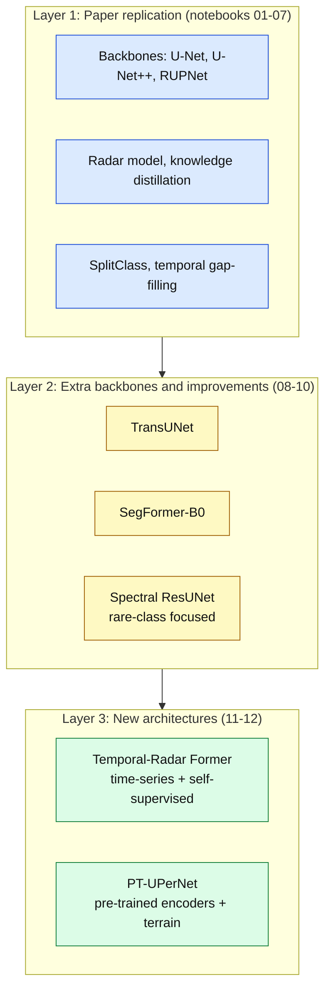

Every stage is a **self-contained Jupyter notebook** (no shared `src/` package), so each can be read and run top to bottom on its own.

---

## 3. Dataset

**IEW-Seg**: co-registered Sentinel-1/2 scenes over two Hungarian national-park sites, all channels resampled to a common **10 m** grid.

| Site | Scene size | Ground area | Train scenes | Test scenes |
|---|---|---|---|---|
| **BNPI** | 3600 × 5400 px | 36 × 54 km (1,944 km²) | 7 | 4 |
| **KNPI** | 2400 × 4800 px | 24 × 48 km (1,152 km²) | 7 | 5 |

The split is **temporal**: test scenes are dates the model never saw, so the score measures generalisation to new weather and seasons.

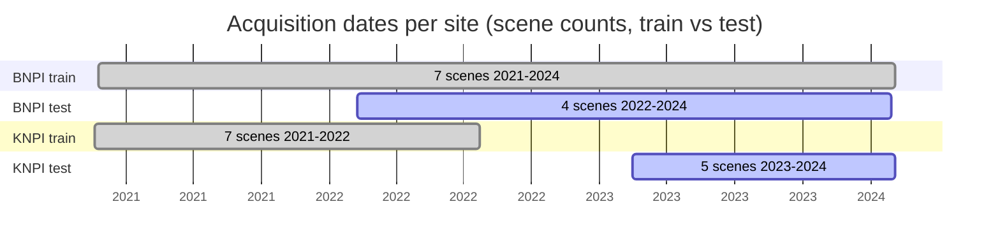

**Per-scene inputs**

| Input | Channels | Notes |
|---|---|---|
| Sentinel-2 | 11 bands (B01–B8A, B11, B12) | Reflectance, DN / 10000 |
| Sentinel-1 | 3: VV, VH, VV/VH ratio (dB) | Standardised |
| Ground truth | 1 | Classes 2–7, with 10 and 11 for cloud and shadow |

**On-disk layout expected by the notebooks**

```text
IEW_seg_DATASET_FINAL/tifs/
├── Train/{GT, GT_0_8, S1, S2}/<SITE>_<YYYYMMDD>.tif
└── Test/{GT, GT_0_8, S1, S2}/<SITE>_<YYYYMMDD>.tif
```

> The dataset is **not** included in this repository. Set `dataset_root` in [configs/data.yaml](configs/data.yaml) to wherever it lives on your machine.

Official dataset page: [waterdetection.github.io/water_detection](https://waterdetection.github.io/water_detection/)

---

## 4. System overview

The full target system combines all the pieces below. Notebooks 01–10 implement the baseline paper design; notebooks 11 and 12 swap in new cores.

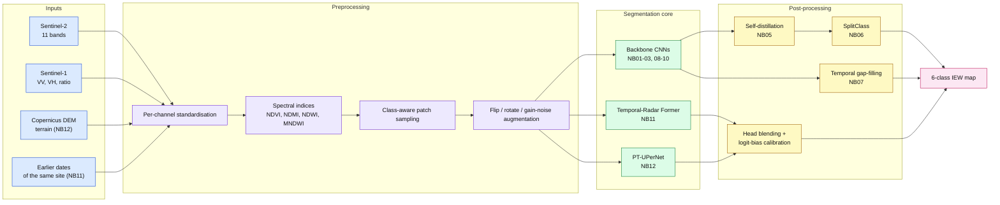

### Data flow of one training step

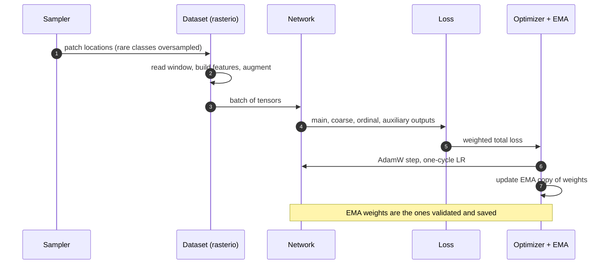

---

## 5. The paper pipeline (notebooks 01–10)

Replication of **"Inland Excess Water (IEW) Monitoring Using Sentinel-1/2: A SplitClass Segmentation and Temporal Gap-Filling Approach"** (ICCV Workshops 2025). The full method walk-through is in [docs/PAPER_WORKFLOW.md](docs/PAPER_WORKFLOW.md).

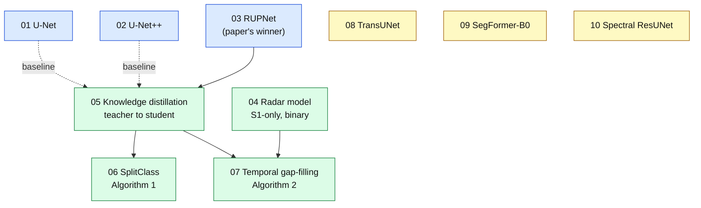

| # | Notebook | What it does | Produces |
|---|---|---|---|
| 01 | [01_unet_backbone](01_unet_backbone.ipynb) | Residual U-Net (32.4 M params), baseline | `unet_best.pt`* |
| 02 | [02_unetpp_backbone](02_unetpp_backbone.ipynb) | U-Net++ with dense skips (9.2 M) | `unetpp_best.pt` |
| 03 | [03_rupnet_backbone](03_rupnet_backbone.ipynb) | RUPNet (2.05 M), the paper's chosen teacher | `rupnet_best.pt` |
| 04 | [04_radar_model](04_radar_model.ipynb) | Binary water model from Sentinel-1 only | `radar_model_best.pt` |
| 05 | [05_knowledge_distillation](05_knowledge_distillation.ipynb) | Self-distillation: frozen RUPNet teacher trains a fresh student with GDL + WFL + KL | `rupnet_student_best.pt` |
| 06 | [06_splitclass_segmentation](06_splitclass_segmentation.ipynb) | Algorithm 1: keep a class where confidence ≥ θ (0.98), else output the top-2 pair | dual-label maps |
| 07 | [07_temporal_gapfilling](07_temporal_gapfilling.ipynb) | Algorithm 2: fill cloud gaps from radar plus flanking clear dates | gap-filled maps |
| 08 | [08_transunet_backbone](08_transunet_backbone.ipynb) | CNN encoder + transformer bottleneck | `transunet_best.pt` |
| 09 | [09_segformer_b0_backbone](09_segformer_b0_backbone.ipynb) | Hierarchical transformer encoder | `segformer_b0_best.pt` |
| 10 | [10_spectral_resunet](10_spectral_resunet.ipynb) | Residual U-Net + per-pixel spectral branch, rare-class sampling, logit calibration | `spectral_resunet_best.pt` |
| – | [eda_sen12flood_precursor](eda_sen12flood_precursor.ipynb) | Exploration of an earlier dataset, not part of the pipeline | – |

\* The `unet_best.pt` checkpoint is not in the repository's `outputs/` folder.

### SplitClass (Algorithm 1)

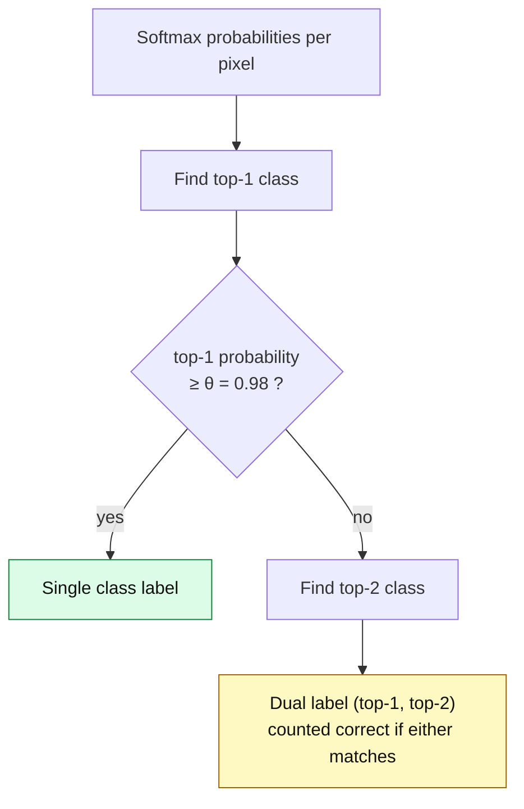

### Temporal gap-filling (Algorithm 2)

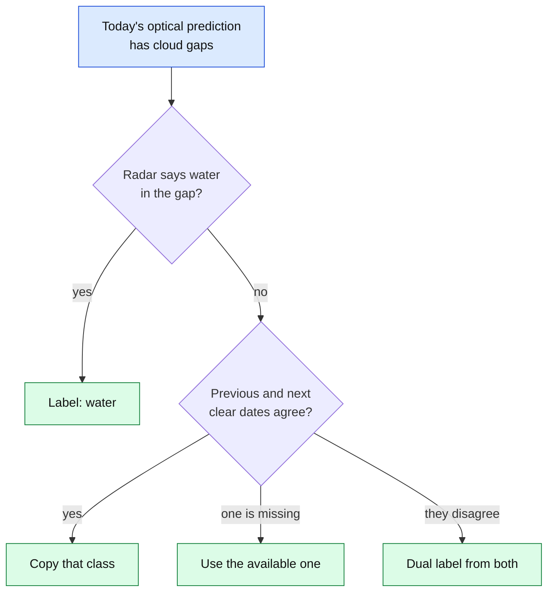

### Losses

| Loss | Role |
|---|---|
| Generalised Dice (GDL) | Overlap-based, robust to class imbalance |
| Weighted Focal (WFL) | Down-weights easy pixels, class-frequency weights |
| KL divergence | Pulls the student toward the teacher (notebook 05 only) |

---

## 6. New architectures (notebooks 11 and 12)

Notebook 10 reached about 98 F1 on water and not-affected, but only 60–71 F1 on the soil-severity classes. The reason is what the model *sees*: one date, one small window, optical-dominated. The two new notebooks change the information, not just the network.

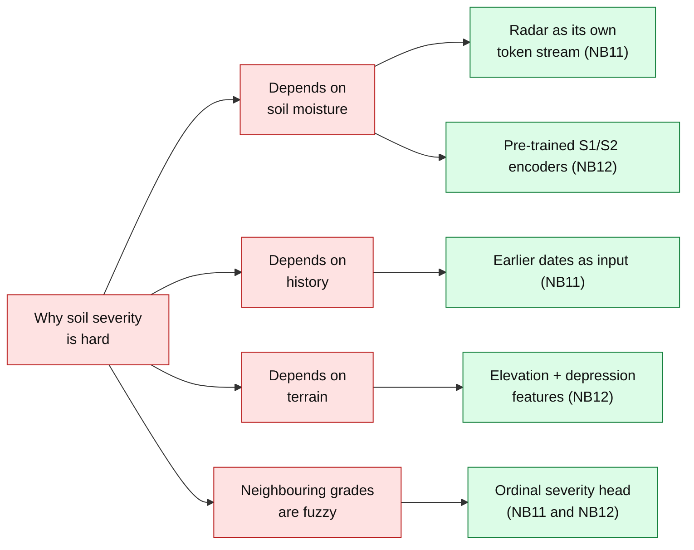

### 6.1 Notebook 11: Temporal-Radar Former (TRF)

[11_temporal_radar_former.ipynb](11_temporal_radar_former.ipynb) · trained on a GPU · ≈ 10–13 M parameters

**Idea:** classify each pixel from a short *history* instead of one snapshot. Each sample is the target date plus up to 3 earlier acquisitions of the same site (imagery only, never their labels).

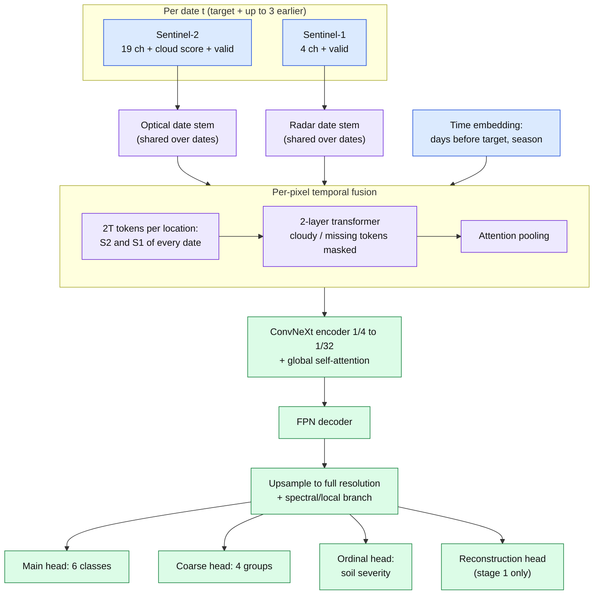

**Two-stage training**

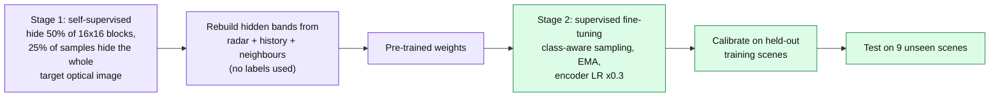

### 6.2 Notebook 12: PT-UPerNet

[12_pretrained_terrain_upernet.ipynb](12_pretrained_terrain_upernet.ipynb) · trained on a GPU · ≈ 60 M parameters, ≈ 47 M pre-trained

**Idea:** start from encoders that already know what Sentinel imagery looks like, and add the terrain information that none of the earlier models had.

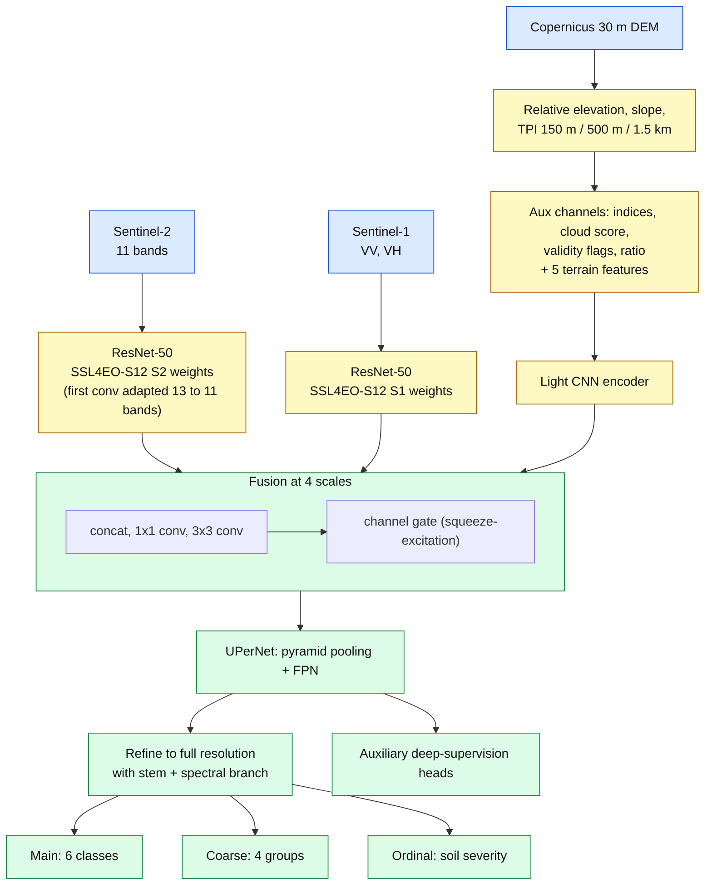

**Why terrain matters:** excess water collects in shallow depressions. The topographic position index (TPI) is a pixel's height minus the average height around it, so negative values mark depressions.


**Fine-tuning schedule**

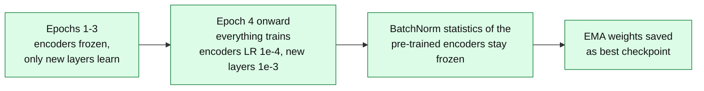

### 6.3 Shared output design (notebooks 11 and 12)

Both models predict the classes in three ways and blend them:

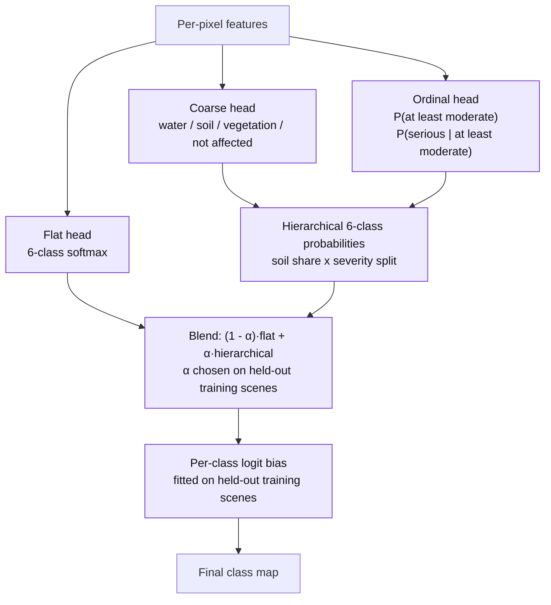

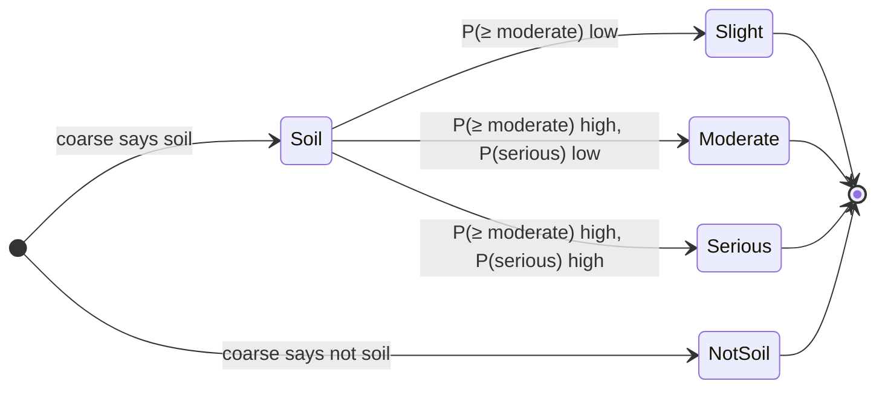

This encodes slight < moderate < serious, so confusing serious with slight costs more than confusing serious with moderate. Training also smooths labels toward neighbouring grades (serious → 90 % serious + 10 % moderate).

### 6.4 How the two models differ

| | Notebook 11 TRF | Notebook 12 PT-UPerNet |
|---|---|---|
| Main bet | **Time**: earlier acquisitions | **Prior knowledge + terrain** |
| Starting weights | Random, then own self-supervised stage | SSL4EO-S12 pre-trained ResNet-50s |
| Extra data needed | None | Copernicus DEM (free) + internet once |
| Dates per sample | Target + up to 3 earlier | Target only |
| Core | Per-pixel temporal transformer → ConvNeXt | Two ResNet-50 + aux CNN → UPerNet |
| Patch / context | 256 px train, 640 px inference windows | 256 px train, 640 px inference windows |
| Handles clouds | Masks cloudy tokens, falls back to radar and history | Validity flags, radar encoder |
| Built-in ablation | Remove context dates, remove radar | Zero the terrain, zero radar |

Because they bet on different information, their errors should differ. **Averaging their calibrated probabilities** is the planned final step.

---

## 7. Results so far

> **Status:** notebooks 01–10 have been run. Notebooks 11 and 12 are **written but not yet run**; their result columns are intentionally empty and are filled by the notebooks themselves into `outputs/trf_results.json` and `outputs/ptuper_results.json`.

All numbers below are on the **9 unseen test scenes** (about 135 million labelled pixels).

### 7.1 Per-class F1 (%), latest run (notebook 10, calibrated)

| Class | F1 | Precision | Recall |
|---|---|---|---|
| Open surface water | **98.62** | 98.19 | 99.04 |
| Soil, seriously affected | 71.04 | 71.25 | 70.83 |
| Soil, moderately affected | 60.20 | 61.22 | 59.21 |
| Soil, slightly affected | 63.54 | 52.50 | 80.46 |
| Vegetation affected | 67.22 | 53.67 | 89.93 |
| Not affected | **98.56** | 99.64 | 97.51 |
| **Macro-F1 (6 classes)** | **76.53** | | |
| **Pixel-weighted F1, classes 2–6 (paper Table 1 metric)** | **81.53** | 75.88 | 90.56 |

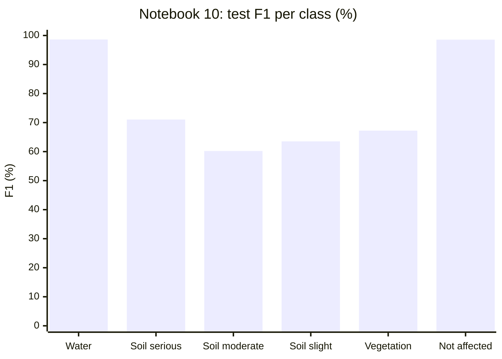

### 7.2 Model comparison

The paper's Table 1 reports F1 over the **five water-related classes only** (2–6), excluding the huge not-affected class. Rows that include class 7 look much higher and are **not comparable** to the paper.

| Model | Params | F1, all 6 classes | F1, classes 2–6 (paper-comparable) |
|---|---|---|---|
| U-Net (NB01) | 32.4 M | 96.90 | not recomputed |
| U-Net++ (NB02) | 9.2 M | 96.79 | not recomputed |
| RUPNet (NB03) | 2.05 M | 94.35 | not recomputed |
| TransUNet (NB08) | – | 93.46 | 63.97 |
| SegFormer-B0 (NB09) | – | 95.65 | 68.47 |
| **Spectral ResUNet (NB10), raw** | 5.2 M | 75.57 macro* | 80.50 |
| **Spectral ResUNet (NB10), calibrated** | 5.2 M | 76.53 macro* | **81.53** |
| *Paper's best (RUPNet, Table 1)* | 2.05 M | – | *81.19* |
| TRF (NB11) | ≈ 10–13 M | to be run | to be run |
| PT-UPerNet (NB12) | ≈ 60 M | to be run | to be run |

\* Notebook 10 reports macro-F1 over the 6 classes, a different aggregation from the pixel-weighted figure used for NB01–03, 08 and 09, so those cells are not directly comparable. The classes 2–6 column is the like-for-like one.

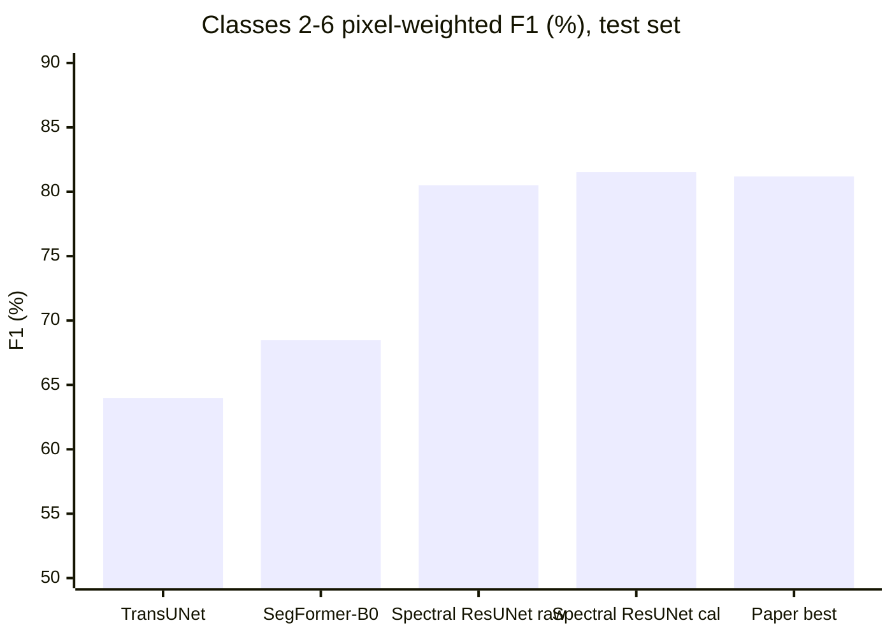

### 7.3 Where the headroom is

| Class | Current F1 | Gap to 90 |
|---|---|---|
| Water | 98.62 | already above |
| Not affected | 98.56 | already above |
| Soil seriously affected | 71.04 | 19 |
| Vegetation affected | 67.22 | 23 |
| Soil slightly affected | 63.54 | 26 |
| Soil moderately affected | 60.20 | 30 |

Reaching 90+ on every class is **not guaranteed**: the boundaries between serious, moderate and slight in the ground truth are themselves fuzzy, and the paper's own best model reached about 81 F1 averaged over classes 2–6. Notebooks 11 and 12 are the attempt to close this gap by adding information, not just capacity.

---

## 8. Training and inference protocol

All of notebooks 10, 11 and 12 use the same protocol, so their numbers can be compared directly.

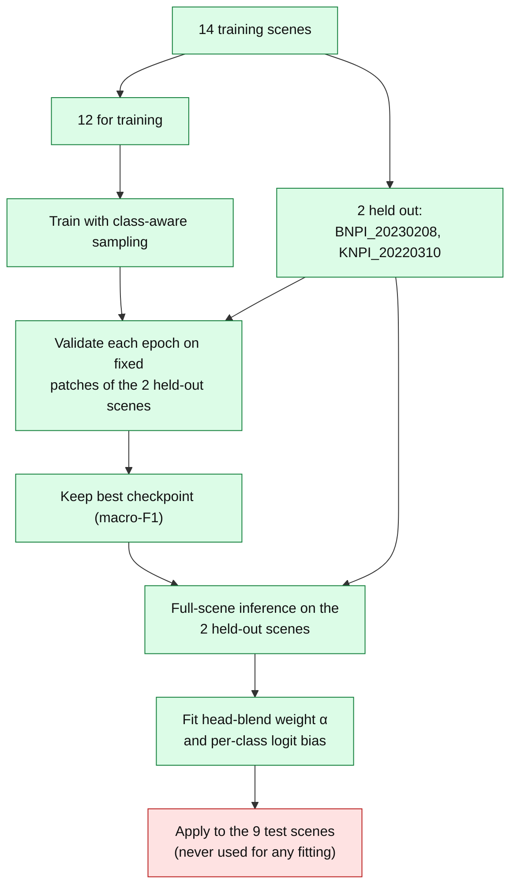

| Component | Setting |
|---|---|
| Optimiser | AdamW with a one-cycle learning-rate schedule |
| Precision | Mixed (bf16 / fp16 on CUDA) |
| Patch size | 96 px (NB10), 256 px (NB11, NB12) |
| Class balance | Per-epoch shares drawn from patches rich in each rare class, plus inverse-square-root class weights |
| Weight averaging | EMA of weights (NB11, NB12) |
| Inference | 640 px windows, centre 512 px kept, no seams; 8-way flip/rotation averaging |
| Calibration | Fitted only on held-out training scenes, never on test |
| Metrics | Per-class precision / recall / F1, macro-F1, and pixel-weighted F1 over classes 2–6 |

---

## 9. Tech stack

| Area | Tools |
|---|---|
| Language and runtime |   |
| Deep learning |     |
| Geospatial |    |
| Satellite data |   |
| Numerics and plots |   |
| Config and docs |    |
| Version control |   |

**Architectures used across the notebooks:** residual U-Net, U-Net++, RUPNet, TransUNet, SegFormer, Spectral ResUNet, ConvNeXt, transformer encoders, FPN, UPerNet, squeeze-and-excitation, ResNet-50 (self-supervised pre-trained).

---

## 10. Quick start

### Requirements

- Python 3.10+ and a CUDA GPU (notebooks 11 and 12 are not practical on CPU; notebooks 01–10 were developed on CPU, but slowly)
- For notebook 12: internet access once (pre-trained weights and elevation tiles)

```bash
pip install torch torchvision          # use the CUDA build for your machine
pip install rasterio numpy pyyaml matplotlib
pip install torchgeo                   # notebook 12 only (also installs timm)
```

### Steps

```mermaid
flowchart LR
    A["1. Get the IEW-Seg<br/>dataset"] --> B["2. Edit dataset_root in<br/>configs/data.yaml"]
    B --> C["3. Open a notebook<br/>in Jupyter"]
    C --> D["4. Dry run:<br/>QUICK_TEST = True"]
    D --> E{"Runs without<br/>errors?"}
    E -- yes --> F["5. QUICK_TEST = False,<br/>Restart and Run All"]
    E -- no --> G["Fix path / memory<br/>settings"]
    G --> D
    F --> H["6. Read outputs/<br/>*_results.json"]
    classDef n fill:#dbeafe,stroke:#1d4ed8,color:#111
    classDef ok fill:#dcfce7,stroke:#15803d,color:#111
    class A,B,C,D,F,G n
    class H ok
```

### Recommended run order

| Goal | Run |
|---|---|
| Reproduce the paper pipeline | 03 → 04 → 05 → 06 and 07 |
| Best current single model | 10 |
| Try the new architectures | 11 and 12 (independent of each other) |
| Final combined result | run 11 and 12, then average their calibrated probabilities |

### GPU memory

The defaults (`PATCH = 256`, `BATCH_SIZE = 8`, mixed precision) need roughly 8–12 GB. If you hit *CUDA out of memory*, set `BATCH_SIZE = 4`, then `PATCH = 192` (must stay divisible by 32).

### Resuming

Notebooks 10, 11 and 12 save a checkpoint every epoch and resume automatically.

---

## 11. Repository layout

```text
.
├── 01_unet_backbone.ipynb               paper baseline backbone
├── 02_unetpp_backbone.ipynb             paper baseline backbone
├── 03_rupnet_backbone.ipynb             paper's winning backbone / KD teacher
├── 04_radar_model.ipynb                 Sentinel-1-only binary model
├── 05_knowledge_distillation.ipynb      teacher to student
├── 06_splitclass_segmentation.ipynb     Algorithm 1
├── 07_temporal_gapfilling.ipynb         Algorithm 2
├── 08_transunet_backbone.ipynb          extra backbone
├── 09_segformer_b0_backbone.ipynb       extra backbone
├── 10_spectral_resunet.ipynb            rare-class-focused model
├── 11_temporal_radar_former.ipynb       NEW: multi-date transformer
├── 12_pretrained_terrain_upernet.ipynb  NEW: pre-trained encoders + terrain
├── eda_sen12flood_precursor.ipynb       exploration of an earlier dataset
├── build_transunet.py                   script that generated notebook 08
├── configs/data.yaml                    dataset path, patch size, classes
├── docs/                                PRD, TRD, plan, results template, paper walk-through
├── papers/                              reference PDFs
├── outputs/                             checkpoints, patch cache, class stats (generated)
├── implementation.md                    implementation-vs-paper report (snapshot, 2026-08-14)
├── LICENSE
└── README.md
```

```mermaid
flowchart TD
    ROOT["flood-segmentation-sentinel12"] --> NB["12 pipeline notebooks<br/>+ 1 EDA notebook"]
    ROOT --> CFG["configs/data.yaml"]
    ROOT --> DOC["docs/ and implementation.md"]
    ROOT --> PAP["papers/ (8 PDFs)"]
    ROOT --> OUT["outputs/<br/>checkpoints, patches, dem, results json"]
    classDef n fill:#dbeafe,stroke:#1d4ed8,color:#111
    class ROOT,NB,CFG,DOC,PAP,OUT n
```

### Generated outputs

| Path | Written by |
|---|---|
| `outputs/checkpoints/*.pt` | each training notebook |
| `outputs/checkpoints/trf_*`, `ptuper_*` | notebooks 11 and 12 (checkpoints, calibration JSON) |
| `outputs/dem/*.npy` | notebook 12 (terrain features per site) |
| `outputs/trf_results.json`, `outputs/ptuper_results.json` | notebooks 11 and 12 (all test metrics) |
| `outputs/class_stats.csv` | class pixel counts per scene |

---

## 12. Documentation map

| Document | Contents |
|---|---|
| [docs/PAPER_WORKFLOW.md](docs/PAPER_WORKFLOW.md) | The paper end to end: problem, dataset, method, experiments |
| [docs/PHASE_1_PRD.md](docs/PHASE_1_PRD.md) | Product requirements |
| [docs/PHASE_2_TRD.md](docs/PHASE_2_TRD.md) | Technical requirements |
| [docs/PHASE_3_IMPLEMENTATION_PLAN.md](docs/PHASE_3_IMPLEMENTATION_PLAN.md) | Milestones |
| [docs/PHASE_4_EXPERIMENTATION_RESULTS.md](docs/PHASE_4_EXPERIMENTATION_RESULTS.md) | Experiment matrix and results template |
| [implementation.md](implementation.md) | Implementation vs. paper alignment, written when only 3 backbones existed |

```mermaid
flowchart LR
    P1["Phase 1<br/>PRD"] --> P2["Phase 2<br/>TRD"] --> P3["Phase 3<br/>Plan"] --> P4["Phase 4<br/>Experiments"]
    P4 --> NB["Notebooks 01-12"]
    classDef n fill:#ede9fe,stroke:#6d28d9,color:#111
    class P1,P2,P3,P4,NB n
```

---

## 13. Known limitations and housekeeping

| Item | Detail |
|---|---|
| Notebooks 11 and 12 | Written and syntax-checked but **not yet run**; expect a first trial run (`QUICK_TEST`) to surface small fixes |
| Notebooks 04–07 | Run correctly in design but not executed end to end in this repository's results |
| 90+ F1 on every class | Not guaranteed; soil-severity labels are inherently fuzzy |
| Metric comparability | Only the classes 2–6 pixel-weighted F1 is comparable to the paper's Table 1 |
| `.gitignore` | The rule for `outputs/checkpoints/*.pt` is commented out, so checkpoints (about 250 MB) are tracked unless it is enabled |
| `configs/data.yaml` | `dataset_root` is a Windows path; edit it for your machine |
| `implementation.md` | A snapshot from before notebooks 08–12 existed; some of its status statements are outdated |
| Transductive option | Notebook 11 can also pre-train on test-split *imagery* (`SSL_USE_TEST_IMAGERY`); off by default and must be disclosed if enabled |

---

## 14. References and license

**Main paper:** Ibrahim, Belényesi, Liu, Richter-Cserey, Simon, Szirányi, Benedek. *Inland Excess Water (IEW) Monitoring Using Sentinel-1/2: A SplitClass Segmentation and Temporal Gap-Filling Approach.* ICCV Workshops 2025 (Sustainability with Earth Observation and AI).
[Paper](https://openaccess.thecvf.com/content/ICCV2025W/Sustainability/html/Ibrahim_Inland_Excess_Water_IEW_Monitoring_Using_Sentinel-12_A_SplitClass_Segmentation_ICCVW_2025_paper.html) · [Dataset page](https://waterdetection.github.io/water_detection/)

**Other references in [papers/](papers/):** Sen1Floods11, H2O-Net, SkySense, EarthDial, SatMAE++, and a multi-sensor geospatial foundation-model paper (CVPR 2024).

**Pre-trained weights and data used by notebook 12:** SSL4EO-S12 (via torchgeo) and the Copernicus GLO-30 digital elevation model.

Released under the [MIT License](LICENSE).
