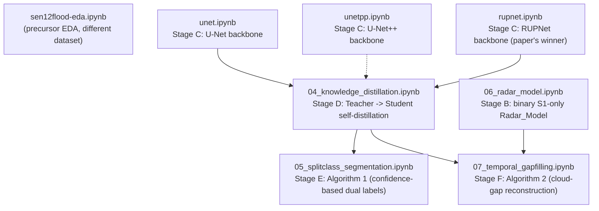

# Inland Excess Water (IEW) Monitoring using Sentinel-1/2

This repository contains the replication codebase for the paper:
**"Inland Excess Water (IEW) Monitoring Using Sentinel-1/2: A SplitClass Segmentation and Temporal Gap-Filling Approach"** (ICCVW 2025, Sustainability with Earth Observation and AI Workshop).

*   **Paper Webpage:** [IEEE/CVF Open Access Paper Page](https://openaccess.thecvf.com/content/ICCV2025W/Sustainability/html/Ibrahim_Inland_Excess_Water_IEW_Monitoring_Using_Sentinel-12_A_SplitClass_Segmentation_ICCVW_2025_paper.html)
*   **Official Website & Dataset:** [Water Detection IEW-Seg Page](https://waterdetection.github.io/water_detection/)
*   **Full method walkthrough:** [`docs/PAPER_WORKFLOW.md`](docs/PAPER_WORKFLOW.md)
*   **Implementation-vs-paper alignment report:** [`implementation.md`](implementation.md)

---

## 1. Project Overview

Inland Excess Water (IEW) — waterlogging and seasonal soil saturation — is a major environmental and agricultural risk factor in low-lying agricultural plains (such as the Hungarian Great Plain). Binary "water vs. non-water" segmentation misses this: the paper instead maps 6 fine-grained classes (open water + 4 soil/vegetation severity gradations + "not affected") and combines two complementary satellite sources:

1.  **Sentinel-2 Optical Data:** 11 bands (excluding B9 and B10), used for fine-grained 6-class classification.
2.  **Sentinel-1 SAR Data:** 3 bands (Sigma-0 VV, VH, and the VV/VH ratio), cloud-penetrating but only resolves binary water/non-water — used for gap-filling.

## 2. Pipeline & Notebook Flow

The project is organized as **7 self-contained Jupyter notebooks**, one per pipeline stage, each runnable independently (later stages load the checkpoint(s) produced by earlier ones). No external `src/`/`scripts/` package — every notebook duplicates its own data pipeline, losses, and model code so it can be read and run top-to-bottom on its own.



| # | Notebook | Paper stage | Produces |
|---|---|---|---|
| — | `sen12flood-eda.ipynb` | precursor EDA (different, earlier dataset — not part of the paper's pipeline) | — |
| 1 | `unet.ipynb` | §4.2 backbone comparison (baseline) | `outputs/checkpoints/unet_best.pt` |
| 2 | `unetpp.ipynb` | §4.2 backbone comparison | `outputs/checkpoints/unetpp_best.pt` |
| 3 | `rupnet.ipynb` | §4.2 backbone comparison (paper's winner) + Stage D teacher | `outputs/checkpoints/rupnet_best.pt` |
| 4 | `04_knowledge_distillation.ipynb` | §3.2/§4.3 self-distillation (Teacher → Student) | `outputs/checkpoints/rupnet_student_best.pt` |
| 5 | `05_splitclass_segmentation.ipynb` | §3.2.1 Algorithm 1 (post-processing, no training) | — |
| 6 | `06_radar_model.ipynb` | §4.1 dual-model strategy, binary S1-only branch | `outputs/checkpoints/radar_model_best.pt` |
| 7 | `07_temporal_gapfilling.ipynb` | §3.2.2 Algorithm 2 | — |

**To reproduce end to end:** run `rupnet.ipynb` → `06_radar_model.ipynb` (independent of the above) → `04_knowledge_distillation.ipynb` → `05_splitclass_segmentation.ipynb` and `07_temporal_gapfilling.ipynb` (either order, both need the student + radar checkpoints). `unet.ipynb`/`unetpp.ipynb` are the other two backbone-comparison runs and aren't required for later stages.

Each notebook follows the same internal structure: imports → data pipeline → dataset visualization → losses → model → dataloaders → training → loss curves → evaluation → prediction visualization, so they're directly comparable to each other.

## 3. Directory Structure (actual, current)

```text
.
├── configs/
│   └── data.yaml                      # Dataset root, patch size, stride, channel/class config
├── docs/
│   ├── PHASE_1_PRD.md                 # Product Requirement Document
│   ├── PHASE_2_TRD.md                 # Technical Requirement Document
│   ├── PHASE_3_IMPLEMENTATION_PLAN.md # Implementation plan and milestones
│   ├── PHASE_4_EXPERIMENTATION_RESULTS.md # Results tracker matrix
│   └── PAPER_WORKFLOW.md              # Full paper method walkthrough + repo mapping
├── outputs/
│   ├── checkpoints/                   # Saved model weights (.pt), one per trained model
│   ├── patches/                       # Cached sliding-window patches
│   └── class_stats.csv                # Pre-computed class pixel distributions
├── papers/                            # Reference PDFs (main paper + related work)
├── sen12flood-eda.ipynb               # Precursor EDA (different dataset)
├── unet.ipynb                         # Stage C: U-Net backbone
├── unetpp.ipynb                       # Stage C: U-Net++ backbone
├── rupnet.ipynb                       # Stage C: RUPNet backbone (+ Stage D teacher source)
├── 04_knowledge_distillation.ipynb    # Stage D: Teacher -> Student self-distillation
├── 05_splitclass_segmentation.ipynb   # Stage E: SplitClass Segmentation (Algorithm 1)
├── 06_radar_model.ipynb               # Stage B: binary Radar_Model (S1-only)
├── 07_temporal_gapfilling.ipynb       # Stage F: Temporal Gap-Filling (Algorithm 2)
└── implementation.md                  # Implementation-vs-paper alignment report
```

There is intentionally no `src/`, `scripts/`, or `tests/` directory — an earlier plan for a modular package layout was superseded by self-contained notebooks (each notebook's own markdown says so); this README previously described the old plan and was out of date.

## 4. Dataset Structure & Splits

### What is a "Scene"?
A **scene** represents a single co-registered spatial area under study on a specific date: aligned Sentinel-1 radar bands, Sentinel-2 optical bands, and ground-truth label maps. Filenames are `<SITE>_<YYYYMMDD>.tif` (e.g., `BNPI_20210223.tif`).

### Pixel Resolution & Ground Area
All channels are on a **10 m** grid (lower-resolution S2 bands and S1 have been resampled to it).
*   **BNPI scenes (3600 × 5400 px):** 36 km × 54 km (1,944 km²). Every BNPI-site date shares this exact grid.
*   **KNPI scenes (2400 × 4800 px):** 24 km × 48 km (1,152 km²). Every KNPI-site date shares this exact grid.

(This per-site grid consistency across all dates is what makes `07_temporal_gapfilling.ipynb`'s cross-date patch lookups valid — a `(y, x)` window means the same ground location on any date of the same site.)

### Physical Disk Layout
```text
IEW_seg_DATASET_FINAL/
└── tifs/
    ├── Train/
    │   ├── GT/        # Ground Truth geotiffs (class labels {2..7, 10, 11})
    │   ├── GT_0_8/    # Contiguous label maps (mapped indices {0..7})
    │   ├── S1/        # Sentinel-1 radar geotiffs (3 bands: VV, VH, VV/VH ratio)
    │   └── S2/        # Sentinel-2 optical geotiffs (11 bands)
    └── Test/
        ├── GT/ GT_0_8/ S1/ S2/        # same structure as Train
```

### Actual Scenes per Split
Temporal split to test generalization to unseen time periods:

#### Training Split (14 scenes)
*   **BNPI (7):** `BNPI_20210223`, `BNPI_20210310`, `BNPI_20230208`, `BNPI_20230213`, `BNPI_20230519`, `BNPI_20240109`, `BNPI_20240203`
*   **KNPI (7):** `KNPI_20210218`, `KNPI_20210223`, `KNPI_20220119`, `KNPI_20220213`, `KNPI_20220310`, `KNPI_20220325`, `KNPI_20220723`

#### Testing Split (9 scenes)
*   **BNPI (4):** `BNPI_20220208`, `BNPI_20220325`, `BNPI_20231125`, `BNPI_20240129`
*   **KNPI (5):** `KNPI_20230213`, `KNPI_20230603`, `KNPI_20240104`, `KNPI_20240129`, `KNPI_20240203`

### Ground Truth Class Encoding
1.  **Open surface water** (Class 2 / Index 0)
2.  **Soil seriously affected by waterlogging** (Class 3 / Index 1)
3.  **Soil moderately affected by waterlogging** (Class 4 / Index 2)
4.  **Soil slightly affected by waterlogging** (Class 5 / Index 3)
5.  **Vegetation affected by waterlogging** (Class 6 / Index 4)
6.  **Not affected areas** (Class 7 / Index 5)

*(Cloud/Shadow classes 10 & 11 are masked out of the loss and out of evaluation.)*

## 5. Current Experimental Results (Stage C, backbone comparison)

All three models trained 40 epochs, GDL+WFL, evaluated on the full non-overlapping test set (32,691 patches / 9 scenes). Two metrics are reported per model:

- **Pixel-weighted, all 6 classes (2-7):** inflated by the dominant "not affected" class (~87% of pixels) — not comparable to the paper.
- **Table-1-comparable, classes 2-6 only:** the paper's own metric definition — this is the number to compare against Table 1.

| Model | Params | F1 (all 6 classes) | F1 (Table-1-comparable, classes 2-6) | Paper F1 (Table 1) |
|---|---|---|---|---|
| U-Net | 32.44M | 96.90% | *(see notebook §10)* | 79.38% |
| U-Net++ | 9.16M | 96.79% | *(see notebook §10)* | 79.10% |
| RUPNet (v1, pre-fix) | 2.05M | 94.35% | *(see notebook §10)* | **81.19% (paper's winner)** |

RUPNet — the paper's best backbone — was the **worst** of the three in the original 40-epoch run, especially on the hard soil-severity classes (3-5). The training log shows it was still improving when training stopped (undertrained relative to its smaller capacity, on a sparse 3,388-patch training set), not architecturally broken — its parameter count (2,048,934) matches the paper's reported 2.05M almost exactly. `rupnet.ipynb` §0 has the full diagnosis and the fix applied (denser training patches, LR warmup, 100-epoch schedule); re-run it to get the updated number. See `implementation.md` for the full writeup.

## 6. Stages D-F (Knowledge Distillation, SplitClass, Gap-Filling)

Now implemented in `04_knowledge_distillation.ipynb`, `05_splitclass_segmentation.ipynb`, `06_radar_model.ipynb`, and `07_temporal_gapfilling.ipynb` (see §2 above for what each produces and the run order). Numbers from these are only meaningful after running them on a machine with a GPU — this repo's dev environment is CPU-only, so they're written to run correctly but haven't been executed here yet. Each notebook ends with a "Summary — fill in after running" cell to record the actual results.

One caveat worth repeating: `07_temporal_gapfilling.ipynb` cannot reproduce the paper's exact Table 3 (field-survey-validated) numbers, because the 2024 QField field-survey file is not present in this repository's dataset copy (see `docs/PHASE_1_PRD.md` §2). It instead implements and evaluates Algorithm 2 against a synthetic cloud-gap proxy — the notebook's own §0 explains the honest scope of that comparison.
