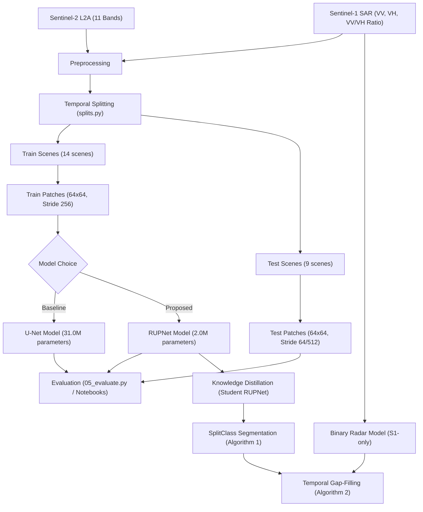

# Inland Excess Water (IEW) Monitoring using Sentinel-1/2

This repository contains the replication codebase for the paper:  
**"Inland Excess Water (IEW) Monitoring Using Sentinel-1/2: A SplitClass Segmentation and Temporal Gap-Filling Approach"** (ICCVW 2025, Sustainability with Earth Observation and AI Workshop).

*   **Paper Webpage:** [IEEE/CVF Open Access Paper Page](https://openaccess.thecvf.com/content/ICCV2025W/Sustainability/html/Ibrahim_Inland_Excess_Water_IEW_Monitoring_Using_Sentinel-12_A_SplitClass_Segmentation_ICCVW_2025_paper.html)
*   **Official Website & Dataset:** [Water Detection IEW-Seg Page](https://waterdetection.github.io/water_detection/)

---

## 1. Project Overview

Inland Excess Water (IEW)—which encompasses waterlogging and seasonal soil saturation—is a major environmental and agricultural risk factor in low-lying agricultural plains (such as the Hungarian Great Plain). 

This project aims to reproduce the paper's framework for fine-grained monitoring of excess water using multi-source satellite data:
1.  **Sentinel-2 Optical Data:** 11 bands (excluding B9 and B10) used for fine-grained classification across 6 waterlogging stages.
2.  **Sentinel-1 SAR Data:** 3 bands (Sigma-0 VV, VH, and the VV/VH ratio) used as a cloud-penetrating radar input for gap-filling.



---

## 2. Directory Structure

```text
.
├── configs/
│   └── data.yaml                 # Dataset paths, bands, class lists, and training parameters
├── docs/
│   ├── PHASE_1_PRD.md            # Product Requirement Document
│   ├── PHASE_2_TRD.md            # Technical Requirement Document
│   ├── PHASE_3_IMPLEMENTATION_PLAN.md # Implementation plan and milestones
│   └── PHASE_4_EXPERIMENTATION_RESULTS.md # Results tracker matrix (template)
├── outputs/
│   ├── checkpoints/              # Saved model weights (.pt files)
│   ├── patches/                  # Cached sliding-window patches
│   └── class_stats.csv           # Pre-computed class pixel distributions
├── scripts/
│   ├── 00_inspect_dataset.py     # Verifies dataset shape, CRS, labels, and bounding boxes
│   ├── 02_class_statistics.py    # Gathers class distribution stats for class weights
│   ├── 03_extract_patches.py     # Performs pre-extraction of patches
│   ├── 04_train.py               # Main training script (supports UNet / RUPNet)
│   ├── 05_evaluate.py            # Custom test set evaluation script
│   └── compute_stats.py          # Script for channel-wise mean and std calculations
├── src/
│   ├── data/
│   │   ├── patch_dataset.py      # PyTorch Dataset implementation
│   │   ├── raster_io.py          # Rasterio geoTIFF helpers
│   │   └── splits.py             # Script aligning S1, S2, and GT splits
│   ├── losses/
│   │   ├── generalized_dice.py   # Class-weighted Generalized Dice Loss
│   │   └── weighted_focal.py     # Class-weighted Focal Loss
│   └── models/
│       ├── rupnet.py             # Residual Upsampling Network architecture (2.05M parameters)
│       └── unet.py               # Baseline U-Net architecture (31.04M parameters)
├── tests/
│   └── test_dataset.py           # Unit tests for Dataset loading
├── unet_baseline.ipynb           # Notebook for baseline U-Net training/evaluation
├── rupnet_training.ipynb         # Notebook for RUPNet training/evaluation
└── sen12flood-eda.ipynb          # Exploratory Data Analysis notebook
```

---

## 3. Dataset Structure & Splits

### What is a "Scene"?
A **scene** represents a single co-registered spatial area under study on a specific date. In our dataset, each scene comprises aligned Sentinel-1 radar bands, Sentinel-2 optical bands, and ground-truth label maps. The filenames are encoded as `<SITE>_<YYYYMMDD>.tif` (e.g., `BNPI_20210223.tif`).

### Pixel Resolution & Ground Area
The pixel size of all channels in the geotiff files is **10 meters** (so each pixel corresponds to a $10\text{m} \times 10\text{m}$ area on the ground). Lower-resolution Sentinel-2 bands (originally 20m) and Sentinel-1 bands have been resampled to this 10m grid.
*   **BNPI scenes ($3600 \times 5400$ pixels):** Cover a physical ground area of **$36\text{km} \times 54\text{km}$** ($1,944 \text{ km}^2$).
*   **KNPI scenes ($2400 \times 4800$ pixels):** Cover a physical ground area of **$24\text{km} \times 48\text{km}$** ($1,152 \text{ km}^2$).

### Physical Disk Layout
The dataset files are stored under the following directory layout:
```text
IEW_seg_DATASET_FINAL/
└── tifs/
    ├── Train/
    │   ├── GT/        # Ground Truth geotiffs (class labels {2..7, 10, 11})
    │   ├── GT_0_8/    # Contiguous label maps (mapped indices {0..7})
    │   ├── S1/        # Sentinel-1 radar geotiffs (3 bands: VV, VH, VV/VH ratio)
    │   └── S2/        # Sentinel-2 optical geotiffs (11 bands)
    └── Test/
        ├── GT/        # Same structure as Train
        ├── GT_0_8/
        ├── S1/
        └── S2/
```

### Actual Scenes per Split
The dataset uses a temporal split to evaluate how well models generalize to unseen time periods:

#### **Training Split (14 Scenes)**
*   **BNPI (7 scenes):**
    *   `BNPI_20210223`, `BNPI_20210310`, `BNPI_20230208`, `BNPI_20230213`, `BNPI_20230519`, `BNPI_20240109`, `BNPI_20240203`
*   **KNPI (7 scenes):**
    *   `KNPI_20210218`, `KNPI_20210223`, `KNPI_20220119`, `KNPI_20220213`, `KNPI_20220310`, `KNPI_20220325`, `KNPI_20220723`

#### **Testing Split (9 Scenes)**
*   **BNPI (4 scenes):**
    *   `BNPI_20220208`, `BNPI_20220325`, `BNPI_20231125`, `BNPI_20240129`
*   **KNPI (5 scenes):**
    *   `KNPI_20230213`, `KNPI_20230603`, `KNPI_20240104`, `KNPI_20240129`, `KNPI_20240203`

### Ground Truth Class Encoding
Each pixel is categorized into one of 6 valid classes:
1.  **Open surface water** (Class 2 / Index 0)
2.  **Soil seriously affected by waterlogging** (Class 3 / Index 1)
3.  **Soil moderately affected by waterlogging** (Class 4 / Index 2)
4.  **Soil slightly affected by waterlogging** (Class 5 / Index 3)
5.  **Vegetation affected by waterlogging** (Class 6 / Index 4)
6.  **Not affected areas** (Class 7 / Index 5)

*(Cloud/Shadow classes 10 & 11 are masked out during loss calculation).*

---

## 4. Current Experimental Results

Both models were trained using Generalized Dice Loss (GDL) + Weighted Focal Loss (WFL) for **8 epochs** with a training stride of `256` (representing 3,388 training patches). Evaluation was performed on non-overlapping test patches (32,691 test patches):

| Metric | U-Net Baseline | RUPNet |
| :--- | :---: | :---: |
| **Model Size (Params)** | 31.04M | **2.05M (15x smaller)** |
| **Training Loss (Epoch 8)** | `1.0217` (Under-converged) | **`0.8400`** (Healthy convergence) |
| **Validation Loss (Epoch 8)**| `1.0207` | **`0.9167`** |
| **Overall Pixel Accuracy** | **31.59%** | **82.22%** |
| **Overall Precision** | **93.43%** | **96.53%** |
| **Overall F1-Score** | **43.75%** | **87.96%** |
| **Class 7 Recall (Not Affected)**| 29.32% | **82.54%** |
| **Class 2 Recall (Open Water)** | 78.49% | **87.87%** |

---

## 5. Next Project Phases

1.  **Knowledge Distillation:** Implement student RUPNet distillation (`scripts/06_distill_student.py`) to transfer features from a frozen RUPNet teacher.
2.  **SplitClass Segmentation:** Implement Algorithm 1 (`src/postprocess/splitclass.py`) to classify low-confidence pixels into dual-class labels.
3.  **Temporal Gap-Filling:** Train a binary Sentinel-1 radar model and implement Algorithm 2 (`src/postprocess/temporal_gapfill.py`) to resolve cloud gaps in optical data.
