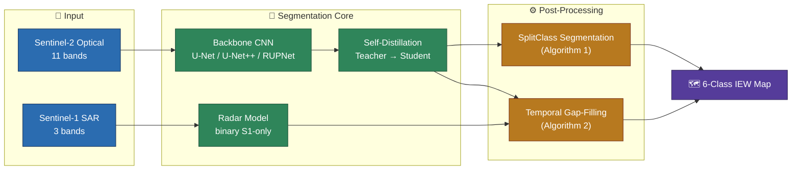
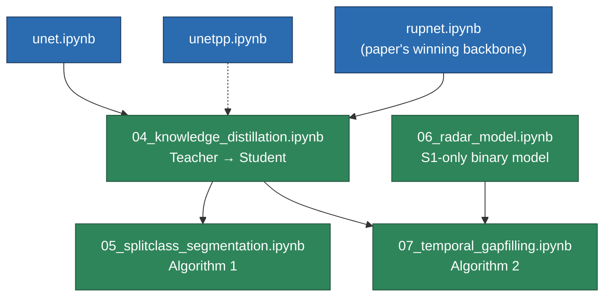

# Inland Excess Water (IEW) Monitoring using Sentinel-1/2

Replication codebase for **"Inland Excess Water (IEW) Monitoring Using Sentinel-1/2: A SplitClass Segmentation and Temporal Gap-Filling Approach"** (ICCVW 2025, Sustainability with Earth Observation and AI Workshop).

- **Paper:** [IEEE/CVF Open Access](https://openaccess.thecvf.com/content/ICCV2025W/Sustainability/html/Ibrahim_Inland_Excess_Water_IEW_Monitoring_Using_Sentinel-12_A_SplitClass_Segmentation_ICCVW_2025_paper.html)
- **Dataset & official page:** [waterdetection.github.io/water_detection](https://waterdetection.github.io/water_detection/)
- **Full method walkthrough:** [`docs/PAPER_WORKFLOW.md`](docs/PAPER_WORKFLOW.md)
- **Implementation-vs-paper alignment report:** [`implementation.md`](implementation.md)

---

## Overview

Binary "water vs. non-water" segmentation misses inland waterlogging. This pipeline instead maps **6 fine-grained classes** (open water + 4 soil/vegetation severity levels + "not affected") by fusing two satellite sources per scene:

| Source | Bands | Role |
|---|---|---|
| **Sentinel-2** (optical) | 11 bands | Fine-grained 6-class segmentation |
| **Sentinel-1** (SAR) | 3 bands — VV, VH, VV/VH | Cloud-penetrating, binary water/non-water gap-filling |

## System Architecture



- **Backbone** learns the 6-class map from Sentinel-2.
- **Self-distillation** compresses the trained teacher into a lighter student.
- **Radar model** independently predicts binary water from Sentinel-1 (works through cloud cover).
- **SplitClass Segmentation** refines confident pixels into dual (class, confidence) labels.
- **Temporal Gap-Filling** uses the radar signal and neighboring dates to reconstruct cloud-obscured pixels in the optical map.

## Pipeline: Notebooks & Data Flow

Each stage is one self-contained Jupyter notebook — no shared `src/` package, so every notebook can be read and run top-to-bottom on its own.



| Notebook | Produces |
|---|---|
| `unet.ipynb` | `outputs/checkpoints/unet_best.pt` |
| `unetpp.ipynb` | `outputs/checkpoints/unetpp_best.pt` |
| `rupnet.ipynb` | `outputs/checkpoints/rupnet_best.pt` (teacher) |
| `04_knowledge_distillation.ipynb` | `outputs/checkpoints/rupnet_student_best.pt` |
| `05_splitclass_segmentation.ipynb` | dual confidence-labeled maps (post-processing, no training) |
| `06_radar_model.ipynb` | `outputs/checkpoints/radar_model_best.pt` |
| `07_temporal_gapfilling.ipynb` | gap-filled temporal maps (post-processing, no training) |

**Reproduce end-to-end:** `rupnet.ipynb` → `06_radar_model.ipynb` (independent) → `04_knowledge_distillation.ipynb` → `05_splitclass_segmentation.ipynb` and `07_temporal_gapfilling.ipynb` (either order). `unet.ipynb` / `unetpp.ipynb` are backbone-comparison baselines only.

> `sen12flood-eda.ipynb` is precursor EDA on a different, earlier dataset — not part of this pipeline.

## Dataset

**IEW-Seg** — co-registered Sentinel-1/2 scenes over two Hungarian sites, all channels resampled to a common **10 m** grid.

| Site | Scene size | Ground area |
|---|---|---|
| BNPI | 3600 × 5400 px | 36 km × 54 km (1,944 km²) |
| KNPI | 2400 × 4800 px | 24 km × 48 km (1,152 km²) |

**Split** (temporal, to test generalization to unseen dates):

| Split | Scenes | Sites |
|---|---|---|
| Train | 14 | 7 BNPI + 7 KNPI |
| Test | 9 | 4 BNPI + 5 KNPI |

**Ground truth classes** (cloud/shadow classes 10 & 11 are masked out of loss and evaluation):

| Class | Meaning |
|---|---|
| 2 | Open surface water |
| 3 | Soil — seriously affected |
| 4 | Soil — moderately affected |
| 5 | Soil — slightly affected |
| 6 | Vegetation affected |
| 7 | Not affected |

**On-disk layout:**

```text
IEW_seg_DATASET_FINAL/tifs/
├── Train/{GT, GT_0_8, S1, S2}/
└── Test/{GT, GT_0_8, S1, S2}/
```

Patches are cut on a 64×64, stride-64 sliding window (`configs/data.yaml`), cached to `outputs/patches/`.

## Current Results (backbone comparison, Stage C)

40 epochs, GDL+WFL loss, evaluated on the full test set (32,691 patches / 9 scenes):

| Model | Params | F1 (all 6 classes) | Paper F1 (Table 1) |
|---|---|---|---|
| U-Net | 32.44M | 96.90% | 79.38% |
| U-Net++ | 9.16M | 96.79% | 79.10% |
| RUPNet | 2.05M | 94.35% | **81.19%** (paper's winner) |

RUPNet — the paper's best backbone — trails here despite matching the paper's parameter count almost exactly; the training log shows it was still improving when the 40-epoch run stopped (undertrained relative to its smaller capacity). See `implementation.md` for the fix and full diagnosis.

Stages D–F (`04`–`07`) run correctly but haven't been executed end-to-end in this repo, since the dev environment is CPU-only.

## Repository Layout

```text
.
├── configs/data.yaml                  # dataset root, patch size/stride, channels, classes
├── docs/                              # PRD, TRD, implementation plan, results tracker, paper walkthrough
├── outputs/                           # checkpoints, cached patches, class stats (generated, gitignored)
├── papers/                            # reference PDFs
├── *.ipynb                            # one notebook per pipeline stage (see table above)
└── implementation.md                  # implementation-vs-paper alignment report
```
