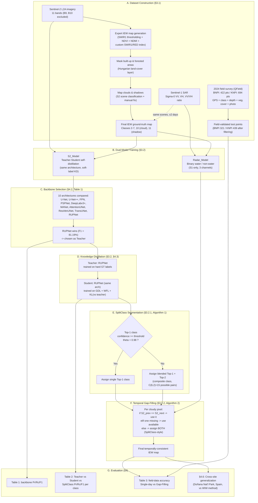

# Paper Workflow — "Inland Excess Water (IEW) Monitoring Using Sentinel-1/2: A SplitClass Segmentation and Temporal Gap-Filling Approach"

> Ibrahim, Belényesi, Liu, Richter-Cserey, Simon, Szirányi, Benedek — ICCV Workshops 2025 (Sustainability with Earth Observation and AI).
> Paper: [IEEE/CVF Open Access](https://openaccess.thecvf.com/content/ICCV2025W/Sustainability/html/Ibrahim_Inland_Excess_Water_IEW_Monitoring_Using_Sentinel-12_A_SplitClass_Segmentation_ICCVW_2025_paper.html) · Dataset/website: [waterdetection.github.io](https://waterdetection.github.io/water_detection/) · Local copy: `papers/main_paper.pdf`

This document walks through **everything the paper does, end to end** — independent of how much of it is currently implemented in this repository (see the main [README.md](../README.md) for that). Its purpose is to give a single, readable account of the problem, the dataset, the method, and the experiments, so the "why" behind each script/module in this repo is clear.

---

## 1. The problem being solved

Two things get mapped worse than they should by existing remote-sensing water tools:

1. **Inland Excess Water (IEW)** — waterlogging and soil/vegetation water stress *short of* open water — is usually invisible to binary "water vs. non-water" segmentation. Most prior work (Sen1Floods11, MM-Flood, S1S2-Water, etc.) only detects flooded/open-water pixels.
2. **Wet–dry transition zones** are graded, not binary — a pixel can be "soil moderately affected," "soil slightly affected," or ambiguous between neighboring severities. Hard single-class labels throw away that ambiguity.

On top of this, optical satellite data (Sentinel-2) is frequently blocked by cloud cover, and radar (Sentinel-1) — while cloud-penetrating — cannot distinguish fine-grained soil-moisture severity, only rough water/non-water.

The paper's answer has **three coupled contributions**:

| # | Contribution | What it does |
|---|---|---|
| 1 | **IEW-Seg dataset** | A new, fine-grained (6-class + cloud/shadow) waterlogging dataset built from S1+S2 imagery over two Hungarian national parks, with field-survey validation. |
| 2 | **SplitClass Segmentation** | An inference-time technique: output a single class where the model is confident, or a blended *pair* of top-2 classes where it isn't — instead of forcing every pixel into one bucket. |
| 3 | **Temporal Gap-Filling** | A framework that fills cloud-obscured Sentinel-2 pixels using a Sentinel-1 radar model plus the nearest cloud-free S2 observations before/after the gap. |

---

## 2. End-to-end pipeline



---

## 3. Dataset construction (§3.1)

### 3.1 Study areas
Two Hungarian national parks were chosen because they experience *both* drought and periodic flooding, which overlap significantly (>70% of Hungary saw drought in the past decade; up to 15% of arable land floods periodically):

- **BNPI** — Heves Steppes, Bükk National Park (scene size 5400×3600 px @ 10 m ⇒ 54 km × 36 km)
- **KNPI** — sodic lakes area, Upper-Kiskunság, Kiskunság National Park (4800×2400 px @ 10 m ⇒ 48 km × 24 km)

### 3.2 Inputs
- **Sentinel-2**: 11 of 13 spectral bands (B9, B10 dropped — poor relevance).
- **Sentinel-1**: Sigma-0 backscatter — VV, VH, and their ratio (3 channels), computed via the Hungarian Earth Observation Information System. S1/S2 acquisitions are matched to within ±2 days.
- **Temporal split**: 14 training scenes (7 BNPI + 7 KNPI) / 9 test scenes (4 BNPI + 5 KNPI). KNPI trains on pre-2023 data and tests on 2023+ (forward generalization); BNPI deliberately tests on *earlier* dates than some training dates (harder generalization check in the other direction).

### 3.3 Ground-truth (IEW map) generation — a 4-step expert pipeline
1. **Initial thematic classification**: visual interpretation + expert, per-image thresholding of SWIR1, combined with NDVI, NDMI, and a custom index `(SWIR1 − RED) / (SWIR1 + RED)` (sensitive to soil moisture). Produces 6 classes: open water, soil (seriously/moderately/slightly affected), vegetation affected, and unaffected.
2. **Masking**: built-up and forested areas removed using a Hungarian high-resolution land-cover layer.
3. **Cloud/shadow mapping**: from S2 scene classification maps, manually corrected.
4. **Integration**: cloud/shadow layers merged into the refined map to produce the final GT.

### 3.4 Class encoding

| ID | Class | Role |
|---|---|---|
| 2 | Open surface water | base class |
| 3 | Soil seriously affected by waterlogging | base class |
| 4 | Soil moderately affected by waterlogging | base class |
| 5 | Soil slightly affected by waterlogging | base class |
| 6 | Vegetation affected by waterlogging | base class |
| 7 | Not affected areas | base class |
| 10 | Cloud / missing data | excluded from loss (masked, no gradient) |
| 11 | Shadow | excluded from loss (masked, no gradient) |

6 base classes ⇒ `C(6,2) = 15` possible SplitClass composite (dual-label) classes.

### 3.5 Field validation data (2024)
Independent ground-truth collected via the **QField** app: GPS coordinates, assigned IEW class, water depth, wet area, vegetation cover/height, a directional photo per point.

- **BNPI**: 9 collection days → 422 samples
- **KNPI**: 12 collection days → 694 samples
- Filtered for evaluation (excluding "water under vegetation" and areas <100 m²) → **321 (BNPI) / 439 (KNPI)** usable points, used only in the Table 3 field-accuracy experiment (§4.5), since cloud cover prevents pixel-level GT for those specific dates.

---

## 4. Proposed method (§3.2)

### 4.1 Why a dual-model strategy?
Optical (S2) and radar (S1) data fail in complementary ways: S2 gives fine-grained severity classes but is blind under clouds; S1 sees through clouds but only resolves *binary* water/non-water (soil and vegetation moisture look too similar in backscatter to reliably separate). So the paper trains two specialized models sharing one architecture, differing only in input channel count:

| Model | Input | Output | Notes |
|---|---|---|---|
| **S2_Model** | 11-band Sentinel-2 | 6-class softmax (teacher) / soft distribution (student) | Trained via teacher→student self-distillation |
| **Radar_Model** | 3-band Sentinel-1 (VV, VH, ratio) | binary water / non-water | All water-affected classes collapsed to one "water" label; cloud/shadow-labeled pixels excluded from the loss (their true state under cloud is unknown) |

Both use **Generalized Dice Loss (GDL)** + **Weighted Focal Loss (WFL)**, with class weights from training-set class frequency (to counter the strong imbalance — open water and "not affected" dominate pixel counts).

### 4.2 Backbone selection (§4.2, Table 1)
Ten segmentation architectures were benchmarked in the top-1 (single-class) setting on S2 data, scored on Pr/Rc/F1 over the five water-related classes (2–6):

| Model | Pr (%) | Rc (%) | F1 (%) |
|---|---|---|---|
| U-Net | 78.58 | 80.20 | 79.38 |
| U-Net++ | 77.61 | 80.87 | 79.10 |
| FPN | 73.31 | 72.55 | 72.93 |
| PSPNet | 69.79 | 69.13 | 69.46 |
| DeepLabv3+ | 72.29 | 73.72 | 73.00 |
| MANet | 77.80 | 80.91 | 79.32 |
| AttentionUNet | 78.40 | 77.06 | 77.77 |
| ResidualAttentionUNet | 77.67 | 78.27 | 77.97 |
| TransUNet | 75.89 | 77.86 | 76.86 |
| **RUPNet** | 76.35 | **86.70** | **81.19** |

**RUPNet** (Tomar, Bagci & Jha, *Medical Imaging 2023* — originally designed for real-time polyp segmentation) wins on F1 and is carried forward as the **teacher** for distillation.

### 4.3 Teacher–student knowledge distillation (§3.2, §4.3)
- **Teacher**: RUPNet trained directly on hard GT labels — objective: produce informative *soft* probabilities, not just correct hard labels.
- **Student**: an identical RUPNet, trained on `GDL + WFL + KL-divergence(student ‖ teacher)` — this is **self-distillation** (same architecture on both sides), which prior work (Zhang et al., 2019) shows can outperform the teacher despite no architectural change.
- Result (Table 2, weighted "All" row, top-1 hard segmentation): Teacher Pr/Rc/F1 = 0.98/0.96/0.97 → Student = 0.98/0.97/0.98 — the student edges out the teacher.

### 4.4 SplitClass Segmentation (§3.2.1, Algorithm 1)
Applied as a **post-processing / inference-time step** on the student's softmax output:

```
for each pixel x_i:
    C_top1 = argmax_k P(x_i, C_k)
    if P(x_i, C_top1) >= threshold:        # theta = 0.98 in the paper
        x_i = C_top1                       # confident -> single class
    else:
        C_top2 = argmax_{k != C_top1} P(x_i, C_k)
        x_i = (C_top1, C_top2)             # uncertain -> composite dual-class label
```

- A prediction counts as correct if **either** of the two assigned classes matches ground truth.
- At θ = 0.98, only **6.33%** of pixels get a dual-class label — a small, interpretable minority.
- Per-class F1 improves most for the **underrepresented, visually-similar classes 3–6** (soil severity gradations), exactly the ambiguous cases the method targets (Table 2 below).
- A small fraction of dual-labels (0.13%) merge *opposite* classes (open water ↔ not-affected) — flagged as boundary noise, not a systemic failure.
- The largest confusion pair is "vegetation affected by water" ↔ "not affected" (2.33%) — attributed to wet vegetation not fully submerged looking similar to unaffected vegetation.

**Table 2 — per-class Pr/Rc/F1, Teacher Top-1 vs Student Top-1 vs SplitClass (θ=0.98):**

| Class ID | Teacher F1 | Student F1 | SplitClass F1 |
|---|---|---|---|
| 2 (open water) | 0.98 | 0.99 | **1.00** |
| 3 (soil, seriously affected) | 0.65 | 0.67 | **0.90** |
| 4 (soil, moderately affected) | 0.58 | 0.58 | **0.87** |
| 5 (soil, slightly affected) | 0.63 | 0.62 | **0.90** |
| 6 (vegetation affected) | 0.67 | 0.77 | **0.94** |
| 7 (not affected) | 0.98 | 0.99 | **1.00** |
| **All (pixel-weighted)** | 0.97 | 0.98 | **0.99** |

### 4.5 Temporal Gap-Filling (§3.2.2, Algorithm 2)
Applied at inference/test time to resolve cloud-covered S2 pixels, combining the Radar_Model's binary output with the nearest cloud-free S2 predictions before and after the gap:

```
Inputs: s2_prev (last cloud-free S2 result), s2_next (next cloud-free S2 result),
        s2_day (today's S2 result, has cloud gaps), radar_mask (today's binary radar result)

mask = (s2_day == missing)
s2_day[mask & (radar_mask == water)] = "water"        # radar fills in open-water pixels

if s2_prev == s2_next:
    s2_day = s2_prev                                    # stable -> use it directly
elif s2_prev or s2_next is missing:
    s2_day = whichever scan is available
else:
    s2_day = (s2_prev, s2_next)                          # disagreement -> SplitClass-style dual label

return s2_day
```

Intuition: if a region was waterlogged in both the scan before and the scan after the cloudy day, it's reasonably inferred to still be waterlogged during the gap; if severity *changed* between the two flanking scans, both classes are kept as a composite label rather than guessing.

---

## 5. Experiments & results (§4)

### 5.1 Field-data validation with gap-filling (§4.5, Table 3)
Comparing single-day predictions (S2_Model where cloud-free, binary Radar_Model elsewhere) against the same pipeline enhanced with Temporal Gap-Filling, scored against the independent field survey:

| Method | BNPI accuracy | KNPI accuracy |
|---|---|---|
| Single-Day | 58.25% | 59.45% |
| **With Temporal Gap-Filling** | **72.27%** | **69.24%** |

Single-day accuracy is low mainly because field data was often collected under cloud cover, forcing reliance on the coarse binary Radar_Model alone. Gap-filling recovers accuracy by borrowing temporal context.

### 5.2 Cross-site generalization (§4.6)
The pretrained model was applied — with **no retraining** — to Doñana National Park, Spain (an ecologically different site), and compared against the existing WIW (Water in Wetlands) reference method:
- Rice fields correctly detected as "vegetation affected by water."
- Some open water correctly separated from vegetation-affected water.
- Areas WIW missed as non-water were captured by this method as vegetation-affected.
- A road between fields was clearly segmented (barely visible in WIW), partially labeled as waterlogged soil.
- Demonstrates the approach transfers beyond the training geography, at least qualitatively.

---

## 6. Key takeaways

1. **Fine-grained IEW mapping requires more than binary water detection** — the paper's 6-class scheme (+ cloud/shadow) with severity gradations for soil and vegetation is the core dataset contribution.
2. **SplitClass Segmentation** is a lightweight, interpretable way to expose model uncertainty at inference time without the cost/complexity of full soft-label storage — it substantially improves F1 on the hardest, most visually ambiguous classes (3–6) at the cost of dual-labeling only ~6% of pixels.
3. **Self-distillation** (teacher/student with identical architecture) gives a small but consistent accuracy edge, independent of SplitClass.
4. **Temporal Gap-Filling** meaningfully improves real-world (field-validated) accuracy by fusing radar's cloud-penetration with the temporal continuity of optical predictions — pure single-day inference is unreliable whenever clouds coincide with the day of interest.
5. **RUPNet** (2.05M parameters) beats larger and more complex architectures (U-Net at 31M params, TransUNet, DeepLabv3+, etc.) on this task, making it an efficient choice as both the standalone model and the KD teacher/student backbone.

---

## 7. How this maps to the repository

This repo (see [README.md](../README.md)) is **7 self-contained Jupyter notebooks**, not a `src/`/`scripts/` package (an earlier plan for that layout was superseded — see README §3):

| Repo file | Paper section |
|---|---|
| `unet.ipynb`, `unetpp.ipynb`, `rupnet.ipynb` | §3.1 dataset handling + §4.2 backbone comparison (3 of 10 architectures) |
| `rupnet.ipynb` (checkpoint reused as teacher) + `04_knowledge_distillation.ipynb` | §3.2 / §4.3 knowledge distillation (teacher/student + KL loss) |
| `05_splitclass_segmentation.ipynb` | §3.2.1 SplitClass Segmentation (Algorithm 1) |
| `06_radar_model.ipynb` | §4.1 binary Radar_Model (S1-only) |
| `07_temporal_gapfilling.ipynb` | §3.2.2 Temporal Gap-Filling (Algorithm 2) |

Every notebook implements GDL + WFL (§3.2's stated loss combination) inline.

Not yet implemented, and blocked or out of scope rather than merely unstarted:
- §4.5 field-data validation against the *real* 2024 field survey — the QField GPS-point file is not present in this repo's dataset copy (see `docs/PHASE_1_PRD.md` §2). `07_temporal_gapfilling.ipynb` implements and evaluates Algorithm 2 against a synthetic cloud-gap proxy instead, and says so explicitly in its own §0.
- §4.2's remaining 7 backbones (FPN, PSPNet, DeepLabv3+, MANet, AttentionUNet, ResAttnUNet, TransUNet) — only U-Net, U-Net++, RUPNet are implemented; a scope decision, not a blocker.
- §4.6 cross-site generalization test (Doñana, Spain) — needs an external S1/S2 scene with a reference water layer, outside this project's current dataset.
